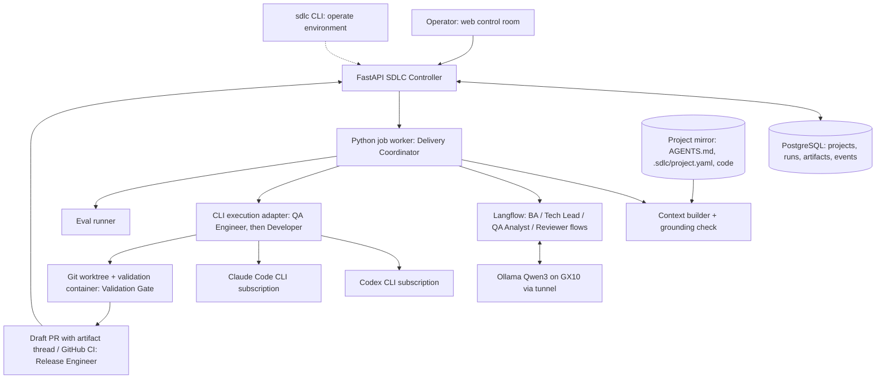

# AI-Native SDLC POC — Option B: Python + PostgreSQL Controller and Langflow AI Orchestrator

**Purpose:** Build durable, auditable SDLC lifecycle control in Python and PostgreSQL. Langflow handles only AI reasoning and returns structured results. PostgreSQL is the single authoritative state store.

**Goal:** Work like a development team in which AI and deterministic components fill the delivery roles and humans keep every decision. The same team must be usable on any company project that is onboarded with a project file, without platform code changes.

**POC scope:** A single-operator sandbox for exploring the concepts of [The AI-native SDLC playbook](https://claude.com/resources/articles/the-ai-native-sdlc-playbook). The operator holds every human role. Findings from the POC feed the design of a company-wide system later (§Path to a company system).

### Revision notes (v3)
- Aligned with the playbook: committed artifact thread (`intent.md`, `spec.md`, `plan.md`, tests, review), Product Owner gates on intent and spec, per-stage autonomy modes, `REVIEW.md`, hooks as guardrails, and evals for configuration changes (§Alignment with the AI-native SDLC playbook).
- POC is single-operator: no user accounts, role assignments or network access. Decisions still record the human role they were made in.
- The reasoning engine per AI role is configurable, so Qwen3 can be compared with alternatives. Qwen3 stays the default.

### Revision notes (v2)
- Added the team model (§AI-native development team), how people use it (§How the team is used) and project onboarding (§Project onboarding).
- The flow now states, for each step, which team role performs it and whether it runs automatically or waits for a human.
- Added code context and a plan grounding check for the AI Tech Lead. In the v1 pilot, all five raw plans needed human correction.
- Extended the state machine, API, data model, phases and acceptance criteria to match.
- Fixed constraints are unchanged: Qwen3 on GX10 through Langflow, Codex and Claude Code through subscriptions, MacBook and GX10 environment, no automatic merge.

## Alignment with the AI-native SDLC playbook

The playbook replaces a linear, handoff-driven SDLC with a loop: AI works at every stage, each stage ends by committing an artifact that the next stage reads, and humans keep judgment and accountability at gates. This POC implements that loop for the stages that do not need production.

### Stage mapping

| Playbook stage | Playbook play | In this POC | Status |
|---|---|---|---|
| Plan | Capture the request as `intent.md`; the Product Owner corrects and accepts it | Web request form with optional AI drafting; submitting accepts `intent.md` | In scope |
| Design | Generate `spec.md` from the accepted intent; flag concerns | Business Analyst writes `spec.md`; Product Owner spec gate | In scope |
| Build | Plan mode, then committed `plan.md`; `CLAUDE.md`/`AGENTS.md`; skills; hooks; parallel worktrees | Tech Lead writes `plan.md` with code context and grounding; human plan gate; Developer in an isolated worktree with hooks | In scope |
| Test | Agents verify their own work; failing test first; agent may not edit tests; evals for configuration | QA Analyst and QA Engineer write tests first; red check; Validation Gate; eval suite over fixed tasks | In scope |
| Deploy | Layered AI review against `REVIEW.md`; humans approve through branch protection; hooks as gates; agent may act up to the production gate and not past it | Code Reviewer follows `REVIEW.md`; draft PR; human merge. No deployment | In scope up to merge |
| Maintain | Detectors on metrics, incidents and scans create new `intent.md` files | Optional B7: a failed CI run on the default branch creates a draft `intent.md` for triage | Later |

### Committed artifact thread
Each stage commits its artifact to the run branch under `.sdlc/runs/<run-id>/`, so the PR carries the full thread and Git history doubles as the audit trail:

| Artifact | Produced by | Accepted by |
|---|---|---|
| `intent.md` | Product Owner (optionally drafted with the Business Analyst) | Product Owner, on submit |
| `spec.md` | Business Analyst | Product Owner (spec gate) |
| `plan.md` (including the test plan and grounding report) | Tech Lead and QA Analyst | Tech Lead (plan gate) |
| Test commits, then implementation commits | QA Engineer, Developer | Validation Gate (deterministic) |
| `review.md` | Code Reviewer | Advisory; read by the Code Owner |
| `report.md` (execution report) | Release Engineer | Code Owner, with the PR |

PostgreSQL remains the authoritative state store; it records each artifact's version and SHA-256. A project can set `artifacts.commit_to_repo: false` to keep the thread only in the controller.

### Autonomy modes
The playbook adopts AI in steps: manual prompting, codified prompts, automated handoffs, then a closed loop. To explore those steps, each stage has a mode in `.sdlc/project.yaml`:

| Mode | Behaviour |
|---|---|
| `manual` | The stage waits until the operator starts it from the web control room |
| `gated` | The stage runs automatically, then waits for human acceptance of its artifact |
| `auto` | The stage runs and hands off without waiting |

Hard rules that no mode can change: plan approval is always `gated`, merge is always a human action in GitHub, and nothing deploys.

## AI-native development team

The platform is organised as a delivery team. Every role has a written contract: what it receives, what it produces, what it may do, and which human is accountable for it. Roles hand work to each other only through versioned artifacts stored by the controller.

### AI and automated roles

| Team role | Played by | Receives | Produces (artifact) | Must not | Accountable human |
|---|---|---|---|---|---|
| **Delivery Coordinator** (Scrum Master) | Python controller and worker, deterministic, no LLM | Work items, human decisions, role outputs | State transitions, routing decisions, notifications, audit events | Make content decisions or edit artifacts | Platform Admin |
| **Business Analyst** | Qwen3 via Langflow `requirements` flow | `intent.md`, `AGENTS.md` | **`spec.md`**: goal, user stories, acceptance criteria, assumptions, concerns, open questions (blocking or non-blocking). On request, also a draft `intent.md` from free text | Invent missing business rules; blocking unknowns become questions | Product Owner |
| **Tech Lead / Architect** | Qwen3 via Langflow `planning` flow | `spec.md`, `AGENTS.md`, code context | **`plan.md`**: tasks, dependencies, files to modify or create, referenced symbols, per-task acceptance criteria, validation names | Approve its own plan; reference code that does not exist | Human Tech Lead |
| **Developer** | Codex CLI or Claude Code CLI, chosen by deterministic routing | One approved task, `AGENTS.md`, task context, isolated worktree | **Commit** for that task, execution log | Touch paths outside the task or protected paths; edit the QA Engineer's tests; push; use the network beyond its CLI vendor | Code Owner |
| **QA Analyst** | Qwen3 via Langflow `test-design` flow | Requirement spec, plan, `AGENTS.md`, existing tests in the code context | **Test plan**: test cases per task, each linked to an acceptance criterion, with expected result and target test file | Design tests for behaviour that is not in the acceptance criteria | Human Tech Lead |
| **QA Engineer** | Codex CLI or Claude Code CLI, in a session separate from the Developer | One approved task's test cases, `AGENTS.md`, existing tests | **Test commit** for that task, written before the implementation | Change source files; delete or weaken existing tests | Human Tech Lead |
| **Validation Gate** | Deterministic validation runner, no LLM | Test commit and task commit | **Validation report**: red check, each allowlisted command, exit code, duration, log | Change code or tests; skip a configured check | Human Tech Lead |
| **Code Reviewer** | Qwen3 via Langflow `review` flow | Full diff, validation reports, `spec.md`, `plan.md`, `AGENTS.md`, `REVIEW.md` | **`review.md`**: findings by review pass with severity (Important or nit), acceptance-criteria coverage, diff-versus-plan comparison | Block or approve the PR; it is advisory | Code Owner |
| **Release Engineer** | Controller GitHub integration | Passed tasks, review report | Branch, **draft PR** with execution report, CI status | Merge, deploy, change CI configuration | Code Owner |

### Human roles

| Human role | Responsibility | Decides |
|---|---|---|
| **Product Owner** (requester) | Writes and accepts `intent.md`, answers the Business Analyst's questions | Accept, revise or reject `spec.md`; whether the delivered result meets the need |
| **Tech Lead** | Reviews the plan; owns `AGENTS.md`, `REVIEW.md` and `.sdlc/project.yaml` | Approve, edit or reject the plan; resume or cancel a run in `NEEDS_HUMAN` |
| **Code Owner** | Reviews the draft PR in GitHub | Merge or request changes; merge happens in GitHub under branch protection |
| **Platform Admin** | Onboards projects; operates the environment (GX10, tunnel, Langflow, subscriptions) | Project registration and platform defaults |

In the POC the operator holds every human role. Each decision still records the role it was made in (for example `acting_role: tech_lead`), so the metrics show where human judgment was needed.

### Reasoning engine per role
Each Qwen3 role can be pointed at another engine to compare results on the same tasks:

```yaml
# controller configuration
reasoning:
  business_analyst: qwen3        # default for every role
  tech_lead: qwen3
  qa_analyst: qwen3
  code_reviewer: qwen3
```

Allowed values: `qwen3` (Langflow and Ollama on GX10), `claude-readonly` and `codex-readonly` (the subscription CLI in read-only or plan mode against the mirror, as in the playbook's plan mode). Langflow remains the only path for `qwen3`; the controller still owns all state.

**Approval (operator, 2026-10-13):** `claude-readonly` and `codex-readonly` may be used for all four thinking roles **in experiments only**: eval runs, or runs the operator explicitly marks as experiments. Normal runs use `qwen3` for every role. Rules:
- The engine of each role is recorded on every execution and shown in eval results.
- These engines send repository content to Anthropic or OpenAI through the operator's subscriptions; no paid API key is used.
- The read-only CLI writes nothing to the mirror. Its output must pass the same JSON Schema and grounding checks as Qwen3 output.
- Subscription usage is recorded per execution so experiments can be compared on cost as well as quality.

### Working agreements
1. **Artifacts, not conversations.** Each AI role works only from the artifacts handed to it. There is no hidden memory between roles. Every artifact is versioned, checksummed, attributed to the role that produced it and, by default, committed to the run branch.
2. **No self-approval.** No role approves its own output, and no AI role approves another AI role's output. Approval authority belongs to humans only.
3. **Escalate instead of guessing.** The Business Analyst asks blocking questions. The Developer reports a blocked task. The Coordinator moves a run to `NEEDS_HUMAN` instead of retrying side effects.
4. **Definition of Ready** (a plan can be shown for approval): schema-valid and passes the grounding check.
5. **Definition of Done.** A task is done when its validation passes and its changed paths obey policy. A run is done when its draft PR, with evidence, is merged by a human.
6. **Same team on every project.** Role contracts do not change per project. Project differences live only in `.sdlc/project.yaml` and `AGENTS.md`.
7. **Every human correction is feedback to a role.** Edits, rejections and failures are classified by category and by the role that caused them (§Failure classification).
8. **Same mistake twice goes into the context file.** When an AI role repeats a mistake, the fix is added to `AGENTS.md` (or `REVIEW.md` for review rules), and the eval suite is rerun.
9. **Tests come from acceptance criteria, not from the implementation.** The QA Engineer writes a task's tests before the Developer starts that task. The Developer may not edit those test files. A Developer who believes a test is wrong reports a test dispute, and the run goes to `NEEDS_HUMAN`.

### AI-written tests
- **Test-first per task.** The QA Engineer commits tests. The Validation Gate runs a **red check**: the new tests must fail on the code before the task. A test that already passes proves nothing and is rejected, unless the test plan marks it `expected_pass` (for example a regression guard). The Tech Lead sees that mark when approving.
- **Independence.** The QA Engineer and the Developer run in separate CLI sessions and see only their own inputs. A project can set `testing.qa_executor` to the other executor (for example Claude writes tests, Codex implements) for stronger independence.
- **No weakening.** The QA Engineer may only add test files or add cases inside `paths.tests`. Changes to existing assertions, skipped tests or deleted tests fail the path and diff check.
- **Remediation.** When validation fails, the Developer fixes the code (maximum two attempts). If the failure is in the tests themselves, the Developer reports a dispute; only a human decides whether the QA Engineer rewrites the test.
- **Review.** The Code Reviewer checks that every acceptance criterion has at least one test, and reports gaps.

## How the team is used

### Human touchpoints
Humans interact with the team at up to four points. Between them, the worker advances the run automatically. No manual command is needed to move a run forward. With the spec gate set to `auto`, there are three.

| When | Who | Where | Action |
|---|---|---|---|
| 1. Intent | Product Owner | Web form | Fill in `intent.md` (problem, desired outcome, affected users and systems, constraints, open questions), optionally drafted by the Business Analyst from free text; submit |
| 2. Spec ready | Product Owner | Web inbox | Read `spec.md` and its concerns; accept, revise or reject; answer questions if any |
| 3. Plan ready | Tech Lead | Web inbox | Read `plan.md`, test plan and grounding report; approve, revise or reject |
| 4. PR ready | Code Owner | GitHub draft PR (link in inbox) | Review code, the artifact thread and `review.md`; merge or request changes |

Exceptions (`NEEDS_HUMAN`, failed classification) also arrive in the inbox of the accountable human.

### Example: one feature on the Task Board project
```text
Web → New request → project: task-board → "Draft with AI" from a pasted description
  → edit intent.md (problem, outcome, users, constraints) → Submit
  Run 7f3c created. Business Analyst is writing spec.md.

  [inbox] spec.md v1 ready: 6 acceptance criteria, 1 concern, no blocking questions
Web → Inbox → "Due dates" → edit one criterion → Accept spec v2

  … Tech Lead (AI) builds plan.md; QA Analyst designs test cases; grounding check passes
  [inbox + browser notification] Plan v1 ready for review: task-board / Due dates

Web → Inbox → "Due dates" → spec, 4 tasks, 11 test cases, grounding: pass → Approve

  … per task: QA Engineer writes tests (red check passes) → Developer (Codex) implements
    → Validation Gate runs the checks
  … Code Reviewer writes review.md against REVIEW.md
  … Release Engineer opens a draft PR with .sdlc/runs/7f3c/{intent,spec,plan,review,report}.md; CI runs
  [inbox + browser notification] PR #12 ready: task-board / Due dates (CI green, review: pass)

  Code Owner reviews and merges PR #12 in GitHub → run COMPLETED
```

### Interfaces
- The **local web control room** on loopback is the only interface for team work: project onboarding, intents, gates, runs, evals and reports.
- The **CLI `sdlc`** only operates the environment, because the web control room cannot start itself and must not be needed to diagnose itself. It has no team commands, so there is one way to do each task.
- GitHub Issues intake is out of scope for the POC.
- Web pages: Inbox (what waits for me), New request (intent form), Runs, Run detail (artifact thread with versions and diffs, grounding report, tasks, validation and review evidence, PR, events), Projects, Evals, Reports.
- Notifications tell a human that the team is waiting for them (clarification, plan, PR, `NEEDS_HUMAN`). In the POC they are the web inbox plus a browser notification while the control room is open. A chat or email channel is deferred until people other than the operator use the team.
- Approving an exact plan version stays mandatory, but the web sends the plan ID and SHA-256 of the version the human is viewing. Humans do not copy hashes.
- The POC has one operator, configured as `SDLC_OPERATOR`. Every decision records the operator and the acting role. User accounts and authentication are out of scope.

### CLI summary
```text
sdlc init                     # create .env with generated secrets
sdlc up | down                # start or stop DB, Langflow, tunnel, API and worker; data is kept
sdlc doctor [--json]          # check every component, with fix hints
sdlc logs <component>         # recent log of one component
```

## Project onboarding

A project joins the team when it is registered and its repository contains, at the root:
- `AGENTS.md`: knowledge for AI roles (§Repository context file). Codex reads it directly. `CLAUDE.md` contains only `@AGENTS.md`, so Claude Code reads the same file.
- `.sdlc/project.yaml`: machine-readable configuration.
- `REVIEW.md` (optional): review passes (for example bugs, security, conformance to spec and plan), what counts as Important versus a nit, and what to skip. Without it, the Code Reviewer uses a platform default.

### `.sdlc/project.yaml`
Read from the pinned base commit of each run, validated against a JSON Schema, and stored as a checksummed artifact. Changes require normal code review.

```yaml
schema_version: 1
project: task-board
default_branch: main
validation_image: node-20            # key from the platform's pinned image catalogue
setup: ["npm", "ci", "--ignore-scripts"]
validation:                          # argument arrays, never shell strings
  - name: unit-tests
    run: ["npm", "test"]
    timeout_seconds: 300
  - name: syntax
    run: ["node", "--check", "src/app.js"]
paths:
  allowed: ["src/**"]                # Developer may only change these
  tests: ["test/**"]                 # QA Engineer may only add tests here
  protected: ["deploy/**"]           # added to platform defaults
testing:
  red_check: true                    # new tests must fail before the implementation
  qa_executor: claude                # optional; default is the Developer's executor in a separate session
context:
  include: ["src/**", "test/**", "README.md"]
  exclude: ["dist/**"]
executors: [codex, claude]
default_executor: codex
limits:
  max_tasks: 6
  max_changed_files: 15
stages:                              # autonomy modes: manual | gated | auto
  spec: gated
  plan: gated                        # cannot be changed
  coding: auto
  review: auto
artifacts:
  commit_to_repo: true               # commit the artifact thread under .sdlc/runs/<run-id>/
```

### Platform defaults and precedence
- The controller configuration holds platform defaults: protected paths (`.env*`, credentials, `.github/workflows/**`, deployment configuration), maximum tasks, maximum changed files, and timeouts.
- A project can only **tighten** them. Protected paths are the union of both lists. Numeric limits take the stricter value. Executors must be enabled on the platform.
- An invalid or loosening configuration rejects the run at preflight with a clear message.

### Onboarding steps
1. Platform Admin: web → Projects → Add, with key and repository URL. This registers the project and creates a local mirror.
2. Tech Lead: commit `AGENTS.md` and `.sdlc/project.yaml` through a normal PR.
3. Web → Projects → Check verifies:
   - `AGENTS.md` and `.sdlc/project.yaml` exist, `CLAUDE.md` imports `AGENTS.md`, and the configuration is schema-valid;
   - the validation image exists;
   - every validation command passes on the default branch head;
   - GitHub access can create a draft PR;
   - CI exists (warning only).
4. Readiness becomes `not_ready`, `plan_only` (files valid, validation not yet passing) or `ready`. Only `ready` projects can reach coding.

## Fixed environment
- ASUS Ascent GX10: Ollama + Qwen3 (`qwen3:30b` initially), remote inference only. The GX10 may be shared with other workloads; the worker checks capacity before loading a model and reschedules if the check fails.
- MacBook Pro M3 Pro / 18 GB: orchestration, Codex CLI, Claude Code CLI, Git worktrees, tests.
- Secure SSH tunnel to GX10: `ssh -N -L 11434:127.0.0.1:11434 USER@GX10_HOST`. `sdlc up` opens it (or reuses one that already listens on the tunnel port); `sdlc doctor` reports its state.
- Ollama health: `curl http://127.0.0.1:11434/api/tags`.
- Codex and Claude Code use eligible interactive subscriptions. Verify current noninteractive CLI support, usage policies and billing behavior; do not silently use paid inference API keys.
- Never expose Ollama or local execution services publicly.

## Shared SDLC flow

| # | Step | Team role | Mode |
|---|---|---|---|
| 1 | Receive the accepted `intent.md`, project and immutable base commit (default branch head unless given) | Product Owner | Human |
| 2 | Preflight: load `.sdlc/project.yaml` and `AGENTS.md` at the base commit, resolve effective policy, check readiness | Delivery Coordinator | Auto |
| 3 | Analyse `intent.md` into `spec.md`; validate structured JSON, mark unknowns and concerns. Blocking questions → `NEEDS_CLARIFICATION` until the Product Owner answers | Business Analyst (Qwen3) | Auto |
| 4 | Accept, revise or reject `spec.md` (skipped when the spec stage is `auto`) | Product Owner | Human |
| 5 | Build code context; write `plan.md`: tasks, dependencies, allowed paths and acceptance criteria | Tech Lead (Qwen3) | Auto |
| 6 | Design test cases per task from the acceptance criteria | QA Analyst (Qwen3) | Auto |
| 7 | Grounding check of plan and test plan; on failure regenerate once with the errors, then present the plan with the errors attached | Delivery Coordinator | Auto |
| 8 | **Human approves the plan and test plan** before any code execution (approve, revise into a new version, or reject) | Tech Lead (human) | Human |
| 9 | Deterministic routing selects Codex or Claude Code for the Developer and the QA Engineer; LLM recommendation is advisory | Delivery Coordinator | Auto |
| 10 | Per task, in dependency order: write the task's tests in the run worktree, then run the red check | QA Engineer, Validation Gate | Auto |
| 11 | Implement the task with the selected CLI | Developer | Auto |
| 12 | Run allowlisted tests, lint and security checks; maximum two remediation attempts per task; a test dispute goes to `NEEDS_HUMAN` | Validation Gate, Developer | Auto |
| 13 | Advisory review of the diff, test evidence and acceptance-criteria coverage against `REVIEW.md`; write `review.md` | Code Reviewer (Qwen3) | Auto |
| 14 | Commit the artifact thread, prepare draft pull request with `report.md`; track CI | Release Engineer | Auto |
| 15 | **Human approves merge** in GitHub | Code Owner | Human |
| 16 | Persist result, timings, errors and audit evidence; request classification where required | Delivery Coordinator | Auto |

## Security requirements
- Use `asyncio.create_subprocess_exec` with argument arrays, never `shell=True`.
- Allowlist repositories, validation commands and modified paths; reject traversal and symlink escapes. Repositories come from the project registry; commands and paths come from the effective project configuration.
- Pin base commit, isolate worktrees, enforce process timeout and kill process group on cancellation.
- Protect secrets, `.env` files, credentials, CI policies and deployment configuration.
- Redact secrets in logs; do not store subscription session tokens in Git or PostgreSQL.
- Treat requirements and repository files, including `AGENTS.md` and `.sdlc/project.yaml`, as untrusted prompt-injection surfaces.
- Restrict outbound access and filesystem permissions where possible; run validation in a pinned container without network; document sandbox limitations.
- Enforce guardrails inside the agent session as well as after it. For Claude Code, pass hook settings through the CLI (not committed to the repository) that block edits to protected paths and to the QA Engineer's tests, and run formatters after edits. For Codex, use workspace-write sandboxing with network disabled. The controller's post-task path and diff checks remain authoritative.
- No automatic merge, production deployment or privileged shell commands.
- Use idempotency keys to avoid duplicate coding executions.

## Shared evaluation criteria
Use at least five fixed feature tasks and the same base commits for Codex and Claude.
Record: JSON schema validity, plan accuracy, successful task completion, test pass rate,
human corrections, execution time, retry count, memory consumption and observable usage.
Test malformed JSON, unavailable Ollama, failed tests, CLI timeout, subscription limits,
duplicate dispatch and human rejection. Report measured results, not assumptions.

Report per team role as well:

| Role | Metrics |
|---|---|
| Business Analyst | Blocking questions per run; acceptance criteria changed by humans |
| Tech Lead (AI) | Plans approved without edits; plan versions per run; grounding failures |
| Developer | Tasks passing validation first time; remediation attempts; path violations |
| QA Analyst | Acceptance criteria without a test case; test cases removed or changed by humans |
| QA Engineer | Red-check failures (tests that already pass); test disputes and how they were decided |
| Validation Gate | Defects found after validation passed (`WEAK_TESTS`) |
| Code Reviewer | Findings the Code Owner agreed with; coverage gaps reported; issues found by humans but missed by review |
| Whole team | Lead time per stage (intent → spec → plan → merge), human waiting time, first-pass merge rate, CI first-pass rate, merged diff matching `plan.md` files |

### Evals for configuration changes
The playbook treats agent configuration as code that needs regression tests. The fixed feature tasks become an eval suite:
- **Suite:** the five Task Board features at their pinned base commit, with the human-approved spec and plan of each as golden references. Later projects add their own suites.
- **Plan-only evals** run Business Analyst, Tech Lead and QA Analyst and compare the result with the golden plan: grounding result, files and tasks matched, acceptance criteria covered. They need only Qwen3 and run in minutes.
- **Full evals** also run coding, validation and review in disposable branches, never merged. They use subscription time, so the operator starts them explicitly.
- **Triggers:** a change to `AGENTS.md`, `REVIEW.md`, prompts, Langflow flows, the model, the reasoning engine of a role or routing rules starts a plan-only eval; the web Evals page shows the delta from the last baseline.
- Every new failure category observed in real runs should add an eval case.

## Instructions to Codex
1. Inspect installed versions and official supported interfaces before coding.
2. Implement in phases, with tests and documentation at each milestone.
3. Pin dependencies; provide `.env.example`, setup instructions and smoke tests.
4. Do not request, print or commit credentials.
5. Never substitute cloud inference APIs without explicit approval. The only approval so far covers `claude-readonly` and `codex-readonly` for thinking roles in experiments (§Reasoning engine per role).
6. Clearly document unsupported capabilities and unresolved risks.
7. Each phase ends with a user-facing demo that follows §How the team is used. Do not hard-code a project, run ID or benchmark into the CLI, web UI or workers.
8. Verify the supported non-interactive, read-only and hook options of the installed Codex and Claude Code versions before relying on them.

## Architecture


## Responsibility boundaries
- **Python Controller:** state machine, approvals, retries, timeouts, audit trail, task DAG, scheduling, recovery and webhook validation. Plays the Delivery Coordinator and Release Engineer roles.
- **Langflow:** requirement extraction, planning and advisory review; no SDLC state transitions. Hosts the Business Analyst, Tech Lead, QA Analyst and Code Reviewer flows.
- **PostgreSQL:** projects, runs, plans, tasks, approvals, executions, events, worker leases, artifact references.
- **Execution worker:** isolated coding CLI subprocesses, tests, logs and Git operations. Plays the QA Engineer, Developer and Validation Gate roles.

## State machine

### Run
`RECEIVED -> PREFLIGHT -> SPECIFYING -> WAITING_SPEC_APPROVAL -> PLANNING -> GROUNDING -> WAITING_PLAN_APPROVAL -> READY -> CODING -> REVIEWING -> PR_OPEN -> WAITING_PR_APPROVAL -> COMPLETED`

Additional states: `NEEDS_CLARIFICATION`, `NEEDS_HUMAN`, `FAILED`, `CANCELLED`, `CLOSED_UNMERGED`.

- `SPECIFYING -> NEEDS_CLARIFICATION -> SPECIFYING` when the Product Owner answers.
- `WAITING_SPEC_APPROVAL` is skipped when the spec stage is `auto`. Revising the spec creates a new version; rejecting it returns to `SPECIFYING` with the reason, or cancels.
- A stage in `manual` mode is entered but does no work (`awaiting_start` is set) until the operator starts it from the inbox.
- `GROUNDING -> PLANNING` once on failure, then `-> WAITING_PLAN_APPROVAL` with the errors attached.
- Revising a plan creates a new immutable plan version, re-runs the grounding check and stays in `WAITING_PLAN_APPROVAL`.
- Rejecting a plan goes to `PLANNING` (replan with the reason) or `CANCELLED`, as the Tech Lead chooses.
- `CODING` covers coding and validation of all tasks; task states carry the detail.
- `WAITING_PR_APPROVAL -> CODING` when the Code Owner requests changes the team should make; this counts as remediation.
- `NEEDS_HUMAN` exits only through a recorded human decision: resume at the failed stage, replan, or cancel.
- `COMPLETED` means a human merged the PR, verified by a GitHub event or API check against the exact head SHA. It does not mean production deployment.

### Task
`PENDING -> READY -> WRITING_TESTS -> RED_CHECK -> CODING -> VALIDATING -> PASSED`, with `VALIDATING -> REMEDIATING -> VALIDATING` at most twice, then `FAILED`. A failed red check returns once to `WRITING_TESTS` with the result, then goes to `NEEDS_HUMAN`. A test dispute sets the task to `DISPUTED` and the run to `NEEDS_HUMAN`. An expired coding lease sets the task to `UNKNOWN` and the run to `NEEDS_HUMAN`; it is never rerun automatically. `CANCELLED` follows run cancellation.

State transitions must be explicit, transactional and version checked.

## API endpoints
| Endpoint | Purpose |
|---|---|
| `GET /api/projects`, `POST /api/projects` | List or register projects |
| `GET /api/projects/{key}` | Project, effective configuration, readiness |
| `POST /api/projects/{key}/check` | Run the onboarding readiness check |
| `POST /api/intents/draft` | Business Analyst drafts `intent.md` from free text (no run is created) |
| `POST /api/runs` | Create run from an accepted `intent.md`, with idempotency key |
| `GET /api/runs` | Filter by project, status, waiting role |
| `GET /api/runs/{id}` | Status, spec, plans, tasks and artifacts |
| `GET /api/runs/{id}/events` | Audit trail |
| `GET /api/inbox` | Items waiting for the operator, grouped by human role |
| `GET /api/meta` | Operator, team mode and the failure classification vocabularies |
| `POST /api/runs/{id}/answers` | Product Owner answers clarification questions |
| `POST /api/runs/{id}/revise-spec`, `approve-spec`, `reject-spec` | Product Owner spec gate, by exact version and SHA-256 |
| `POST /api/runs/{id}/start-stage` | Start a stage that is in `manual` mode |
| `POST /api/runs/{id}/revise-plan` | Append a versioned, audited correction; still require human approval |
| `POST /api/runs/{id}/approve-plan` | Human approval of exact plan ID and SHA-256 |
| `POST /api/runs/{id}/reject-plan` | Human rejection with reason and next step (replan or cancel) |
| `POST /api/runs/{id}/resume` | Human decision on a `NEEDS_HUMAN` run |
| `POST /api/runs/{id}/cancel` | Cancel and signal running worker |
| `POST /api/runs/{id}/pr-decision` | Code Owner decision: `approve` (records a simulated merge until B4; afterwards only a verified GitHub merge completes a run), `request_changes` or `close`; never auto-merge |
| `POST /api/runs/{id}/classify-failure` | Human records root cause category, stage, role and note |
| `GET /api/reports` | Team metrics per project, role, executor and stage |
| `POST /api/evals`, `GET /api/evals/{id}` | Start an eval run; results and delta from baseline |
| `POST /api/webhooks/github` | Verify signed GitHub events, update CI, review and merge status |

Without a public webhook, the worker polls GitHub for CI, review and merge status of open PRs.

## Data model
Use SQLAlchemy + Alembic migrations. Required tables:
- `projects(id, key UNIQUE, repo_url, default_branch, mirror_path, readiness, active, created_at)`
- `runs(id, project_id, base_commit, title, executor, status, version, failure_category, failure_stage, failure_role, failure_note, created_at, updated_at)`
- `documents(id, run_id, kind (intent, spec, review, report), version, sha256, author_kind (ai, human), author, content, repo_path, created_at)`
- `clarifications(id, run_id, question, blocking, answer, answered_at_role, created_at, answered_at)`
- `plans(id, run_id, version, sha256, author_kind (ai, human), author, payload_jsonb, test_plan_jsonb, grounding_report_jsonb, created_at)` (the SHA-256 covers plan and test plan)
- `tasks(id, run_id, plan_id, external_task_id, payload_jsonb, status, version, attempt_count)`
- `approvals(id, run_id, stage (spec, plan, pr), document_id NULL, plan_id NULL, actor, acting_role, decision, reason, created_at)`
- `executions(id, run_id, task_id NULL, role, kind, idempotency_key UNIQUE, worker_id, lease_until, status, executor_or_model, prompt_version, result_jsonb, duration_ms)`
- `pull_requests(id, run_id, number, head_sha, ci_status, review_status, merged_sha)`
- `events(id, run_id, project_id, actor, acting_role, event_type, payload_jsonb, created_at)`
- `eval_runs(id, suite, trigger, config_fingerprint, scope (plan, full), status, results_jsonb, baseline_id, created_at)`
- `artifacts(id, run_id, kind, role, content, checksum, created_at)` (small snapshots such as the project configuration and `AGENTS.md`; large logs move to files in B4)

Every AI role's work is one `executions` row, linked to the artifacts it produced. Use foreign keys, transaction boundaries, status indices and uniqueness constraints.

## Worker reliability
- Begin with a single PostgreSQL-backed polling worker; Redis is not required.
- The worker advances every run that is not waiting for a human; no manual command is required between human touchpoints.
- Acquire jobs atomically with `FOR UPDATE SKIP LOCKED`, lease and heartbeat.
- On crash, reconcile expired leases and existing worktrees/processes; **do not blindly rerun** side-effecting coding tasks.
- Store execution ID before launching CLI and use idempotency keys.
- Persist approval state across restarts; no process should remain blocked waiting for human input.
- LLM calls can retry with bounded exponential backoff; coding remediation maximum two attempts.
- Validate every Langflow response using Pydantic/JSON Schema.

## Repository context file
Every onboarded repository must contain a versioned agent context file (`AGENTS.md`) at its root. It is the single source of project knowledge for all AI roles. Keep it short (about a page, as the playbook recommends) and add recurring mistakes to it.

Required contents:
- Build, run and test commands (must match the validation commands in `.sdlc/project.yaml`).
- Code conventions: structure, naming, error handling, test style.
- Architecture notes: module boundaries and key design decisions with their rationale.
- Prohibited actions: protected paths, forbidden dependencies, files that must never be modified.

Rules:
- Inject the file into the planning step and the coding step; pass it to the review step together with the acceptance criteria.
- Read it from the pinned base commit, record its checksum in `artifacts`, and reject the run if the file is missing.
- Treat it as code: changes require human review. It is still repository content, so it does not override the security requirements.
- When a failure is classified as `MISSING_CONTEXT`, update this file before rerunning the task.

### Code context for the Tech Lead
`AGENTS.md` alone is not enough to plan against real code. Before planning, the context builder reads the mirror at the base commit and assembles:
- a repository map filtered by `context.include` and `exclude`;
- a symbol list (exported functions, classes, storage keys, routes);
- the files most relevant to the spec (named files, keyword and symbol matches, their direct imports and tests).

The bundle fits a configurable token budget for the Qwen3 context window. It is stored as an artifact so the prompt is reproducible. Repository content is labelled as data in prompts.

### Plan grounding check
Deterministic, before human review. A plan fails when:
- a file to modify or a referenced file does not exist at the base commit, or a referenced symbol is not in the symbol list;
- a file to create already exists;
- a path is outside `paths.allowed`, is protected, or escapes the repository;
- a dependency is unknown or cyclic;
- a validation name is not configured;
- task or changed-file limits are exceeded;
- an acceptance criterion has no test case, a test case points to an unknown task or criterion, or a target test file is outside `paths.tests`.

The grounding report is shown to the Tech Lead with the plan and test plan.

## Failure classification
Every run that ends in `FAILED`, `NEEDS_HUMAN` or `CLOSED_UNMERGED`, and every run that required human correction (a revised or rejected plan, or changes requested on the PR), must be assigned a root cause by a human reviewer. The Coordinator places the request in the reviewer's inbox.

| Category | Meaning |
|---|---|
| `AMBIGUOUS_SPEC` | Requirement or acceptance criteria were unclear or incomplete |
| `MISSING_CONTEXT` | Agent lacked project knowledge that a team member would have |
| `BAD_GROUNDING` | Plan referenced wrong or nonexistent code although the context was available |
| `WEAK_TESTS` | Validation passed but the change was wrong, or tests could not detect the defect |
| `MODEL_LIMITATION` | Spec, context and tests were adequate; the model still failed |
| `INFRASTRUCTURE` | Tunnel, CLI, subscription limit, timeout or tooling failure |
| `OTHER` | Requires a free-text explanation |

Rules:
- Store `failure_category`, `failure_stage` (preflight, specification, planning, test_design, grounding, test_writing, coding, validation, review, pr, ci), `failure_role` (the team role whose output was wrong) and `failure_note` on the run; record the classification as an event.
- Qwen3 may suggest a category, but the human decision is authoritative.
- One primary category per run; secondary causes go in the note.
- The benchmark report must include the distribution of categories per executor, per stage and per role, and the corrective action taken for each.

## Repository layout
```text
poc-option-b/
  docker-compose.yml
  .env.example
  controller/app/{main,config,models,schemas,state_machine,worker}.py
  controller/app/api/{projects,runs,approvals,inbox,reports,webhooks}.py
  controller/app/team/{coordinator,analyst,tech_lead,qa_analyst,qa_engineer,developer,validation_gate,reviewer,release}.py
  controller/app/context/{mirror,repo_map,symbols,grounding}.py
  controller/app/artifacts/{thread,documents}.py
  controller/app/evals/{suite,runner,compare}.py
  controller/app/projects/{registry,config,readiness}.py
  controller/app/integrations/{langflow,github}.py
  controller/app/executors/{codex,claude,git_workspace,validation}.py
  controller/migrations/
  controller/tests/{unit,integration,e2e}/
  cli/sdlc/
  web/
  schemas/{project,intent,spec,plan,test-plan,review}.json
  langflow/flows/{intent-draft,requirements,planning,test-design,review}.json
  evals/task-board/{suite.yaml,golden/}
  examples/task-board/{AGENTS.md,CLAUDE.md,REVIEW.md,.sdlc/project.yaml}
  fixtures/sample-feature.md
  docs/{architecture,team,user-guide,onboarding,runbook,security,evals,benchmark}.md
  scripts/{preflight,smoke-test}.sh
```

## Implementation phases
Each phase ends with tests, documentation and a demo a new user can follow from `docs/user-guide.md`.

**B1 — Foundation:** PostgreSQL + Langflow Compose, FastAPI skeleton, migrations, tunnel connectivity and health checks. `sdlc up`, `sdlc down`, `sdlc doctor`.

**B2 — Durable controller and team skeleton:** projects and configuration loading, state transitions, autonomy modes, audit events, spec and plan gates, task DAG, job leasing, worker restart recovery, automatic progression, artifact thread, web control room (projects, intent form, inbox, run detail), worker started by `sdlc up`. All team roles mocked for deterministic tests.

**B3 — Thinking roles:** Business Analyst (intent draft and `spec.md`), Tech Lead, QA Analyst and Code Reviewer (`REVIEW.md`) flows in Langflow, plan-only evals with the Task Board golden plans, Ollama Qwen3 connection, code context, grounding check, schema validation, clarification loop, error handling.

**B4 — Doing roles:** QA Engineer and Developer (Codex/Claude CLI adapters, separate sessions, in-session hooks), Validation Gate (red check, validation container), Release Engineer (draft PR, CI tracking by polling and signed webhook), Git worktrees, bounded subprocesses.

**B5 — Reliability:** crash/restart tests, duplicate jobs, human approval across restarts, timeout/cancellation, invalid model output, GitHub event replay.

**B6 — Experiments and second project:** full evals; compare reasoning engines (`qwen3`, `claude-readonly`, `codex-readonly`) for each thinking role, and Codex with Claude Code as Developer and QA Engineer, on the same suite; onboard a second repository with a different stack using only the onboarding files; produce the per-role report.

**B7 — Close the loop (optional):** a deterministic detector watches CI on the default branch of onboarded projects; a failure creates a draft `intent.md` in the inbox for triage.

## Acceptance criteria
- [ ] Controller persists authoritative run state and audit events in PostgreSQL.
- [ ] Restart does not lose approvals or duplicate coding execution.
- [ ] Invalid transitions and stale approval versions are rejected.
- [ ] Langflow performs reasoning only; no competing SDLC state machine.
- [ ] Codex and Claude are selectable via supported subscription login.
- [ ] No cloud inference API is needed for orchestration.
- [ ] Isolated worktrees, tests, security restrictions and retry caps work.
- [ ] Draft PR produced with evidence; no automatic merge.
- [ ] Automated unit/integration tests and a repeatable demo are provided.
- [ ] Planning and coding steps receive the repository context file from the pinned base commit.
- [ ] Every failed or human-corrected run has a recorded failure category, and the benchmark reports the distribution.
- [ ] Every team role has a documented contract in `docs/team.md` (input, output schema, limits, accountable human), and every artifact names the role that produced it.
- [ ] Between human touchpoints, runs advance without any manual command, except stages the operator set to `manual`.
- [ ] The operator sees what waits for each human role in the inbox, and never copies run IDs or hashes between commands.
- [ ] Each PR carries the committed artifact thread (`intent.md`, `spec.md`, `plan.md`, `review.md`, `report.md`), and each artifact's SHA-256 matches the controller record.
- [ ] Spec gate, autonomy modes and the hard rules (plan gate, human merge, no deploy) behave as configured.
- [ ] A change to `AGENTS.md`, `REVIEW.md`, prompts, flows, model or routing triggers a plan-only eval and reports the delta from the baseline.
- [ ] Each thinking role can run on `qwen3`, `claude-readonly` or `codex-readonly` in experiments; normal runs use `qwen3`; results report quality and usage per engine.
- [ ] A new user starts the environment with `sdlc up` and completes the demo using only `docs/user-guide.md`.
- [ ] Plans referencing nonexistent files or symbols, protected paths or unknown validations are rejected before human review.
- [ ] A second repository with a different stack is onboarded with `AGENTS.md` and `.sdlc/project.yaml` only, without platform code changes.
- [ ] The report shows corrections and failures per team role.
- [ ] Every acceptance criterion has at least one AI-written test; new tests fail before the implementation (red check) unless marked `expected_pass` and approved.
- [ ] The Developer cannot modify the QA Engineer's tests, and existing tests cannot be deleted, skipped or weakened.

## Open questions
| Question | Why it matters | Owner |
|---|---|---|
| Which company repository is the second pilot project (B6), and what is its stack? | Task Board is a small Node demo. Multi-project use is only proven when a real repository with another stack is onboarded without platform code changes. It should have tests and CI and should not be business-critical. | Operator |

Decided:
- Single operator; no accounts, identities or network access.
- Requests are entered through the web control room; GitHub Issues intake is out of scope.
- Notifications are the web inbox and browser notifications.
- `claude-readonly` and `codex-readonly` are approved for all four thinking roles in experiments only; `qwen3` is the default (§Reasoning engine per role).

## Path to a company system
The POC should answer these questions before a company-wide design starts:
- Which stages produce artifacts that humans accept without edits, and which need the most human judgment (per-role metrics)?
- Can Qwen3 hold the thinking roles, or do some need a stronger engine?
- Do `AGENTS.md`, `REVIEW.md` and `.sdlc/project.yaml` capture what a new project needs, without platform code changes?
- Which guardrails were actually triggered, and which failure categories dominate?

Known changes for the company system, out of scope here: multiple users with company identity and per-project roles, shared hosting instead of one MacBook, licensing for unattended multi-user use of coding agents, an existing system of record (for example Jira) linked to `intent.md`, chat notifications, and the Maintain stage on real production signals.

## Go / no-go for Option B
Prefer Option B if recovery, long-lived approvals, traceability, CI callbacks or future multi-user operation are essential. It costs more initial engineering than Option A but offers clearer control boundaries.
