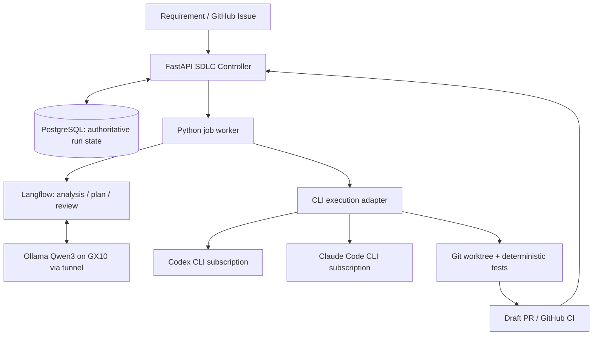

# AI-Native SDLC POC — Option B: Python + PostgreSQL SDLC Controller with Langflow AI Reasoning

**Purpose:** Build durable, auditable SDLC lifecycle control in Python and PostgreSQL. Langflow handles only AI reasoning and returns structured results. PostgreSQL is the single authoritative state store.


## Fixed environment
- ASUS Ascent GX10: Ollama + Qwen3 (`qwen3:30b-instruct` for the current POC), remote inference only.
- MacBook Pro M3 Pro / 18 GB: Python SDLC control, Langflow AI reasoning, Codex CLI, Claude Code CLI, Git worktrees, tests.
- Secure SSH tunnel to GX10: `ssh -N -L 11434:127.0.0.1:11434 USER@GX10_HOST`.
- Ollama health: `curl http://127.0.0.1:11434/api/tags`.
- Codex and Claude Code use eligible interactive subscriptions. Verify current noninteractive CLI support, usage policies and billing behavior; do not silently use paid inference API keys.
- Never expose Ollama or local execution services publicly.

## Shared SDLC flow
1. Receive feature request, repository identifier and immutable base commit.
2. Qwen3 analyzes requirements; validate structured JSON and mark unknowns.
3. Qwen3 proposes tasks, dependencies, allowed paths and acceptance criteria.
4. **Human approves the plan** before any code execution.
5. Deterministic routing selects Codex or Claude Code; LLM recommendation is advisory.
6. Create a separate Git worktree and invoke the selected CLI.
7. Run allowlisted tests, lint and security checks; maximum two remediation attempts.
8. Qwen3 performs advisory review of the diff and test evidence.
9. Prepare draft pull request with execution report; **human approves merge**.
10. Persist result, timings, errors and audit evidence.

## Security requirements
- Use `asyncio.create_subprocess_exec` with argument arrays, never `shell=True`.
- Allowlist repositories, validation commands and modified paths; reject traversal and symlink escapes.
- Pin base commit, isolate worktrees, enforce process timeout and kill process group on cancellation.
- Protect secrets, `.env` files, credentials, CI policies and deployment configuration.
- Redact secrets in logs; do not store subscription session tokens in Git or PostgreSQL.
- Treat requirements and repository files as untrusted prompt-injection surfaces.
- Restrict outbound access and filesystem permissions where possible; document sandbox limitations.
- No automatic merge, production deployment or privileged shell commands.
- Use idempotency keys to avoid duplicate coding executions.

## Shared evaluation criteria
Use at least five fixed feature tasks and the same base commits for Codex and Claude.
Record: JSON schema validity, plan accuracy, successful task completion, test pass rate,
human corrections, execution time, retry count, memory consumption and observable usage.
Test malformed JSON, unavailable Ollama, failed tests, CLI timeout, subscription limits,
duplicate dispatch and human rejection. Report measured results, not assumptions.

## Instructions to Codex
1. Inspect installed versions and official supported interfaces before coding.
2. Implement in phases, with tests and documentation at each milestone.
3. Pin dependencies; provide `.env.example`, setup instructions and smoke tests.
4. Do not request, print or commit credentials.
5. Never substitute cloud inference APIs without explicit approval.
6. Clearly document unsupported capabilities and unresolved risks.

## Architecture


## Responsibility boundaries
- **Python Controller:** state machine, approvals, retries, timeouts, audit trail, task DAG, scheduling, recovery and webhook validation.
- **Langflow:** requirement extraction, planning and advisory review; no SDLC state transitions.
- **PostgreSQL:** runs, tasks, approvals, executions, events, worker leases, artifact references.
- **Execution worker:** isolated coding CLI subprocesses, tests, logs and Git operations.

## State machine
`RECEIVED -> ANALYZING -> PLANNING -> WAITING_PLAN_APPROVAL -> READY -> CODING -> VALIDATING -> REVIEWING -> PR_READY -> WAITING_PR_APPROVAL -> COMPLETED`.

Also `FAILED`, `CANCELLED`, `NEEDS_HUMAN`. State transitions must be explicit, transactional and version checked. `COMPLETED` means approved PR workflow, not production deployment.

## API endpoints
| Endpoint | Purpose |
|---|---|
| `POST /api/runs` | Create run with idempotency key |
| `GET /api/runs/{id}` | Status, tasks and artifacts |
| `GET /api/runs/{id}/events` | Audit trail |
| `POST /api/runs/{id}/revise-plan` | Append a versioned, audited correction; still require human approval |
| `POST /api/runs/{id}/approve-plan` | Human approval of exact plan version |
| `POST /api/runs/{id}/reject-plan` | Human rejection with reason |
| `POST /api/runs/{id}/cancel` | Cancel and signal running worker |
| `POST /api/runs/{id}/approve-pr` | Record human decision; never auto-merge |
| `POST /api/runs/{id}/classify-failure` | Human records root cause category, stage and note |
| `POST /api/webhooks/github` | Verify signed GitHub events, update CI status |

## Data model
Use SQLAlchemy + Alembic migrations. Required tables:
- `runs(id, repo_id, base_commit, requirement, status, version, failure_category, failure_stage, failure_note, created_at, updated_at)`
- `tasks(id, run_id, external_task_id, payload_jsonb, status, attempt_count)`
- `approvals(id, run_id, stage, plan_version, actor, decision, reason, created_at)`
- `executions(id, task_id, idempotency_key UNIQUE, worker_id, lease_until, status, result_jsonb)`
- `events(id, run_id, event_type, payload_jsonb, created_at)`
- `artifacts(id, run_id, kind, storage_path, checksum, created_at)`

Use foreign keys, transaction boundaries, status indices and uniqueness constraints.

## Worker reliability
- Begin with a single PostgreSQL-backed polling worker; Redis is not required.
- Acquire jobs atomically with `FOR UPDATE SKIP LOCKED`, lease and heartbeat.
- On crash, reconcile expired leases and existing worktrees/processes; **do not blindly rerun** side-effecting coding tasks.
- Store execution ID before launching CLI and use idempotency keys.
- Persist approval state across restarts; no process should remain blocked waiting for human input.
- LLM calls can retry with bounded exponential backoff; coding remediation maximum two attempts.
- Validate every Langflow response using Pydantic/JSON Schema.

## Repository context file
The pilot repository must contain a versioned agent context file (e.g. `AGENTS.md`) at its root. It is the single source of project knowledge for all AI steps.

Required contents:
- Build, run and test commands (must match the allowlisted validation commands).
- Code conventions: structure, naming, error handling, test style.
- Architecture notes: module boundaries and key design decisions with their rationale.
- Prohibited actions: protected paths, forbidden dependencies, files that must never be modified.

Rules:
- Inject the file into the planning step and the coding step; pass it to the review step together with the acceptance criteria.
- Read it from the pinned base commit, record its checksum in `artifacts`, and reject the run if the file is missing.
- Treat it as code: changes require human review. It is still repository content, so it does not override the security requirements.
- When a failure is classified as `MISSING_CONTEXT`, update this file before rerunning the task.

## Failure classification
Every run that ends in `FAILED` or `NEEDS_HUMAN`, and every run that required human correction before PR approval, must be assigned a root cause by a human reviewer.

| Category | Meaning |
|---|---|
| `AMBIGUOUS_SPEC` | Requirement or acceptance criteria were unclear or incomplete |
| `MISSING_CONTEXT` | Agent lacked project knowledge that a team member would have |
| `WEAK_TESTS` | Validation passed but the change was wrong, or tests could not detect the defect |
| `MODEL_LIMITATION` | Spec, context and tests were adequate; the model still failed |
| `INFRASTRUCTURE` | Tunnel, CLI, subscription limit, timeout or tooling failure |
| `OTHER` | Requires a free-text explanation |

Rules:
- Store `failure_category`, `failure_stage` (analysis, planning, coding, validation, review) and `failure_note` on the run; record the classification as an event.
- Qwen3 may suggest a category, but the human decision is authoritative.
- One primary category per run; secondary causes go in the note.
- The benchmark report must include the distribution of categories per executor and per stage, and the corrective action taken for each.

## Repository layout
```text
poc-option-b/
  docker-compose.yml
  .env.example
  controller/app/{main,config,models,schemas,state_machine,worker}.py
  controller/app/api/{runs,approvals,webhooks}.py
  controller/app/integrations/{langflow,github}.py
  controller/app/executors/{codex,claude,git_workspace}.py
  controller/migrations/
  controller/tests/{unit,integration,e2e}/
  langflow/flows/{requirements,planning,review}.json
  fixtures/sample-feature.md
  docs/{architecture,runbook,security,benchmark}.md
  scripts/{preflight,smoke-test}.sh
```

## Implementation phases
**B1 — Foundation:** PostgreSQL + Langflow Compose, FastAPI skeleton, migrations, tunnel connectivity and health checks.

**B2 — Durable controller:** state transitions, audit events, approvals, task DAG, job leasing, worker restart recovery. Use mocked LLM/CLI for deterministic tests.

**B3 — AI integration:** Langflow flows for requirements/planning/review, Ollama Qwen3 connection, schema validation, error handling.

**B4 — Coding integration:** Codex/Claude CLI adapters, Git worktrees, bounded subprocesses, test runner, draft PR, signed CI webhook.

**B5 — Reliability:** crash/restart tests, duplicate jobs, human approval across restarts, timeout/cancellation, invalid model output, GitHub event replay.

## Acceptance criteria
- [ ] Controller persists authoritative run state and audit events in PostgreSQL.
- [ ] Restart does not lose approvals or duplicate coding execution.
- [ ] Invalid transitions and stale approval versions are rejected.
- [ ] Langflow performs reasoning only; no competing SDLC state machine.
- [ ] Codex and Claude are selectable via supported subscription login.
- [ ] No cloud inference API is needed for requirements analysis, planning or review.
- [ ] Isolated worktrees, tests, security restrictions and retry caps work.
- [ ] Draft PR produced with evidence; no automatic merge.
- [ ] Automated unit/integration tests and a repeatable demo are provided.
- [ ] Planning and coding steps receive the repository context file from the pinned base commit.
- [ ] Every failed or human-corrected run has a recorded failure category, and the benchmark reports the distribution.

## Go / no-go for Option B
Prefer Option B if recovery, long-lived approvals, traceability, CI callbacks or future multi-user operation are essential. It costs more initial engineering than Option A but offers clearer control boundaries.
