# Thiết kế Discovery: từ raw requirement tới SRS và SDS

_16/10/2026 · bản nháp để duyệt · áp dụng cho mọi dự án_

Một dự án mới thường chỉ có tài liệu thô từ sales hoặc product: slide, file Word, Excel, biên bản họp. Discovery biến chúng thành một **baseline requirement** đã làm rõ và có truy vết. SRS và SDS được viết từ baseline đó, thay vì từ form brief gõ tay như hiện nay.

Thiết kế là **chung cho mọi dự án**. Code và prompt không chứa domain, tên actor hay cấu trúc tài liệu của một dự án cụ thể; mọi khác biệt giữa các dự án nằm trong cấu hình. File `GTV_DVS_Function_Mappingactor_feature_14102026.pdf` (VMS) chỉ dùng làm một trong các bộ dữ liệu chạy thử.

## 1. Luồng

```mermaid
flowchart LR
  src["1 Sources<br/><small>tải tài liệu thô</small>"] --> ext["2 Extract<br/><small>BA (AI) lập bảng requirement</small>"]
  ext --> gap["3 Gaps<br/><small>câu hỏi theo vai</small>"]
  gap --> clr["4 Clarify<br/><small>trả lời, biên bản, quyết định</small>"]
  clr -- "nguồn hoặc câu trả lời mới" --> ext
  clr --> base{{"Baseline<br/>PO chốt phạm vi"}}
  base --> srs["5 SRS run<br/><small>BA viết từ baseline</small>"]
  srs --> g1{{"G1<br/>duyệt / ký SRS"}}
  g1 --> opt["6 Options<br/><small>Architect so sánh phương án</small>"]
  opt --> pick{{"SA chọn phương án"}}
  pick --> sds["7 SDS<br/><small>Architect viết theo phương án</small>"]
  sds --> g2{{"G2<br/>duyệt SDS"}}
```



| # | Bước | AI làm | Người làm | Sản phẩm |
|---|---|---|---|---|
| 1 | Sources | Chuyển file sang dạng đọc được; đếm trang/slide | Sales, PO tải lên | Nguồn có phiên bản và SHA-256 |
| 2 | Extract | Lập bảng requirement theo schema chung (mục 3), mỗi dòng ghi nguồn; chuẩn hoá actor, đánh ID, lập glossary | BA rà và sửa | `requirements/inventory.md` |
| 3 | Gaps | Liệt kê chỗ thiếu, mâu thuẫn, mơ hồ thành câu hỏi theo loại; gán người trả lời theo cấu hình | PO phân loại chặn / không chặn | `requirements/questions.md` |
| 4 | Clarify | Soạn câu hỏi cho từng buổi workshop; đọc biên bản tải lên, rút ra quyết định; cập nhật bảng requirement | Người được giao trả lời trên control room | `requirements/decisions.md` |
| — | **Baseline** | Kiểm tra theo checklist (mục 6) | **PO chốt** phạm vi giai đoạn | `requirements/baseline.md`, PR vào repo |
| 5 | SRS | Viết `SRS.md` từ baseline; mỗi FR trỏ về REQ/quyết định | PO, BA duyệt; khách hàng ký | `SRS.md` (G1) |
| 6 | Options | So sánh các phương án kiến trúc có trong nguồn hoặc do Architect đề xuất | **SA chọn**, TA xác nhận hạ tầng | Phương án đã chọn → SDS §9 |
| 7 | SDS | Viết `SDS.md` theo phương án đã chọn | TA, SA duyệt; bảo mật review | `SDS.md` (G2) |

Bước 2–4 lặp nhiều vòng. Mỗi vòng tạo một phiên bản mới của bảng requirement, câu hỏi và quyết định; không vòng nào ghi đè lịch sử.

## 2. Mô hình dữ liệu và vòng đời

Discovery là một **loại run mới** (`kind: discovery`), mỗi dự án có một discovery đang mở tại một thời điểm. Run này dùng lại toàn bộ cơ chế hiện có: document có phiên bản và hash, approval, event, log trực tiếp, checklist ở cổng, PR.

| Bảng / document | Nội dung |
|---|---|
| `sources` (bảng mới) | dự án, run, tên file, loại, kích thước, SHA-256, số trang, người tải, thời điểm; file nằm trong `.data/projects/<key>/sources/` |
| document `inventory` | Bảng requirement (JSON trong `data`, Markdown để đọc), có phiên bản |
| `questions` (mở rộng bảng `clarifications`) | câu hỏi, loại, mức chặn, vai trả lời, trạng thái (open / answered / deferred / withdrawn), tham chiếu REQ và nguồn, câu trả lời, người trả lời, thời điểm |
| document `decisions` | Nhật ký quyết định: nội dung, ai quyết, khi nào, căn cứ (câu trả lời, biên bản, email) |
| document `baseline` | Ảnh chụp bảng requirement và quyết định tại lúc PO chốt, kèm phạm vi giai đoạn |

Trạng thái của discovery run:

`RECEIVED → INGESTING → EXTRACTING → CLARIFYING ⇄ EXTRACTING → WAITING_BASELINE_APPROVAL → PR_OPEN → WAITING_PR_APPROVAL → COMPLETED`

- `CLARIFYING` chờ người trả lời. Khi có câu trả lời, biên bản hoặc nguồn mới, người dùng bấm **Re-extract** để BA cập nhật bảng.
- Chốt baseline sẽ commit thư mục `requirements/` lên branch của run và mở draft PR. Merge PR thì discovery hoàn tất, và run SRS được phép bắt đầu.
- File thô **được commit vào repo** cùng baseline, trong `requirements/sources/` (quyết định 16/10/2026: tài liệu hợp đồng đã được audit trước khi tải lên). `requirements/sources.md` liệt kê từng file, hash và trang đã trích. Dự án nào không muốn đưa file thô vào repo thì đặt `discovery.commit_sources: false`.

## 3. Schema chung của bảng requirement

Mọi dự án dùng cùng một schema, ánh xạ thẳng vào khung SRS công ty. Trường nào nguồn không có thì để trống và sinh câu hỏi; AI không tự điền cho đủ.

| Loại mục (`type`) | Trường chính | Vào SRS |
|---|---|---|
| `goal` | mục tiêu, giá trị, chỉ số thành công | §1.1–1.2 |
| `actor` | tên chuẩn, tên gọi khác trong nguồn, mô tả, phạm vi dữ liệu | §1.5 |
| `permission` | actor, feature, được làm gì, phạm vi, không được làm gì | §1.5, §7 |
| `feature` | nhóm chức năng, mô tả, giai đoạn, ưu tiên | §3, §7 |
| `function` | thuộc feature, mô tả, actor, sự kiện kích hoạt | §3 (FR), §7 (US) |
| `flow` | các bước theo thứ tự, actor từng bước | §6 |
| `rule` | phát biểu MUST / MUST NOT / MAY, thực thể, ngưỡng | §2.3 |
| `entity` / `data` | thực thể, thuộc tính, chủ sở hữu (system of record), thời hạn lưu | §2 |
| `integration` | hệ thống, chiều, giao thức, dữ liệu trao đổi | §8 |
| `exception` | tình huống, cách xử lý mong muốn | §6 (negative), EC |
| `acceptance` | Given / When / Then nếu nguồn có | AC của US |
| `nfr` | loại (hiệu năng, sẵn sàng, bảo mật, riêng tư…), chỉ số, mục tiêu | §4 |
| `constraint` | pháp lý, thiết bị, hạn chót, ngân sách | §1.3 |
| `option` | phương án triển khai/kiến trúc mà nguồn đưa ra | đầu vào bước 6 |
| `term` | thuật ngữ và nghĩa | §1.4 |

Mỗi mục có: `id` ổn định (`REQ-001`…, controller đánh số), `type`, `text`, `phase` (giai đoạn, nếu nguồn nêu), `status` (`proposed` / `confirmed` / `changed` / `out_of_scope`), và **`sources`**: danh sách `{source_id, location}`, trong đó `location` là trang, slide hoặc đoạn. Mục được tạo từ một quyết định thì trỏ tới quyết định đó.

Chuẩn hoá áp cho mọi dự án:
- Các tên actor đồng nghĩa được gộp về một tên chuẩn, giữ lại tên gốc làm alias. Gộp nào không chắc thì sinh câu hỏi.
- ID trong nguồn được giữ ở trường `source_ref` (ví dụ "BR-01" của một chức năng). ID của hệ thống luôn duy nhất trong toàn dự án.
- Glossary được gom từ mọi nguồn, mỗi thuật ngữ ghi nguồn đầu tiên nêu nó.

## 4. Câu hỏi

Loại câu hỏi chung: `scope`, `actor`, `permission`, `rule`, `threshold` (số liệu hoặc ngưỡng thiếu), `data`, `integration`, `nfr`, `exception`, `acceptance`, `compliance` (pháp lý, dữ liệu cá nhân), `deployment`, `conflict` (hai nguồn nói khác nhau), `missing_source` (nguồn tham chiếu tới thứ không có).

- Mỗi câu hỏi có: loại, câu hỏi, lý do hỏi, REQ và nguồn liên quan, gợi ý câu trả lời nếu có, `blocking` (chặn baseline hay không), và **vai trả lời**. Vai được gán theo loại câu hỏi, cấu hình ở mục 7.
- Câu hỏi gửi khách hàng đi qua vai được cấu hình (thường là Sales). Ai trả lời được ghi lại, và câu trả lời ghi rõ "từ khách hàng, qua Sales".
- **Workshop:** BA (AI) soạn danh sách câu hỏi cho buổi họp, nhóm theo vai tham dự. Sau buổi họp, tải biên bản lên; BA rút ra quyết định và đánh dấu câu hỏi đã được trả lời. Người có vai tương ứng duyệt từng quyết định trước khi nó được tính.

## 5. Nối vào run SRS và SDS hiện có

- **Run SRS:** đầu vào đổi từ brief sang **baseline đã merge**; form brief vẫn giữ cho dự án nhỏ không có tài liệu thô. Prompt BA nhận các mục `confirmed` và `changed` cùng các quyết định. SRS thêm phụ lục "Truy vết requirement": mỗi FR và US trỏ về REQ hoặc quyết định. Khung §1–§8 không đổi.
- **Run SDS:** thêm bước **Options** trước khi viết SDS. Architect lập bảng so sánh phương án (lấy từ các mục `option` của baseline cùng phương án tự đề xuất) theo NFR, chi phí, rủi ro, dữ liệu cá nhân và vận hành. SA chọn ở một cổng riêng, và lý do chọn đi thẳng vào SDS §9.
- **Thay đổi sau baseline:** mở một discovery mới với nguồn mới. Khi baseline mới được chốt, run SRS cập nhật `SRS.md`, giữ ID cũ và ghi lịch sử thay đổi.

## 6. Checklist ở các cổng (cùng ba nhóm như hiện nay)

| Cổng | Controller tự kiểm (trượt thì chặn) | AI tự kiểm | Người tick |
|---|---|---|---|
| Extract (không phải cổng; hiện trên trang) | mọi mục có nguồn hoặc quyết định; ID không trùng; actor trong `permission` đều đã khai báo | độ phủ nguồn: mọi trang/slide có nội dung đã được đọc | — |
| **Baseline** (PO) | không còn câu hỏi chặn đang mở; mọi `feature` trong phạm vi có ít nhất một `function`; mọi `function` có actor; mục `conflict` đã được giải quyết | các ngưỡng và NFR đều có số hoặc được hoãn kèm lý do | phạm vi đúng với điều đã thoả thuận với khách hàng; các mục hoãn chấp nhận được; danh sách actor và quyền đầy đủ |
| G1 SRS, Options, G2 SDS | như các cổng SRS/SDS hiện có, cộng thêm: mọi REQ `confirmed` trong phạm vi được ít nhất một FR hoặc US dùng tới | như hiện có | như hiện có; cổng Options: phương án đáp ứng NFR và ngân sách |

## 7. Cấu hình theo dự án

Trong `.sdlc/project.yaml`, mục `discovery`. Bỏ trống thì dùng mặc định của nền tảng.

```yaml
discovery:
  roles:                       # vai người của dự án; id dùng ở các mục dưới
    - {id: po, name: Product Owner}
    - {id: ba, name: Business Analyst}
    - {id: sa, name: Solution Architect}
    - {id: ta, name: Technical Architect}
    - {id: qc, name: QC}
    - {id: dpo, name: Data Protection Officer}
    - {id: sales, name: Sales (đầu mối khách hàng)}
  question_owners:             # loại câu hỏi -> vai trả lời
    scope: po
    permission: po
    threshold: po
    nfr: ta
    deployment: sa
    integration: ta
    compliance: dpo
    acceptance: qc
    customer: sales            # câu hỏi chỉ khách hàng trả lời được
  approvers: {baseline: po, srs: po, options: sa, sds: ta}
  commit_sources: true         # file thô vào repo cùng baseline (tài liệu được audit trước khi tải lên)
  limits:
    max_rounds: 5              # số vòng re-extract trước khi cần PO xác nhận tiếp tục
    max_questions_per_round: 30
    max_source_mb: 50
    max_pages_per_source: 300
```

Nền tảng (`.env`): loại file nhận (`DISCOVERY_ACCEPTED_TYPES`), engine của BA và Architect cho discovery (theo `SDLC_ENGINES` như các vai khác), số trang đọc trong một lần gọi.

## 8. Đọc nguồn

- **PDF và ảnh:** Claude Code đọc trực tiếp bằng công cụ Read. Một lần đọc tối đa 20 trang, nên controller chia nguồn dài thành nhiều lượt và gộp kết quả.
- **DOCX, XLSX, PPTX:** chuyển sang văn bản bằng thư viện chuẩn trước (giải nén XML). Mỗi đoạn hoặc ô giữ vị trí (trang, sheet!ô, slide) để dùng làm `location`.
- **Văn bản dán vào** (email, chat): lưu thành một nguồn `.md`.
- Vai AI chạy ở chế độ chỉ đọc như hiện nay. Thư mục nguồn được đưa vào cho AI đọc nhưng không bao giờ ghi.
- Dữ liệu cá nhân hay sinh trắc học trong nguồn không được đưa vào bảng requirement, chỉ mô tả loại dữ liệu. AI tự kiểm mục này, và checklist có mục tương ứng.

## 9. Giao diện

Trang dự án có thêm mục **Discovery**:

| Tab | Nội dung | Thao tác |
|---|---|---|
| Sources | Danh sách file, hash, số trang, trạng thái đã đọc | Tải lên (kéo thả), dán văn bản, thay phiên bản mới |
| Requirements | Bảng requirement, lọc theo loại, feature, giai đoạn, trạng thái; bấm vào nguồn để xem trang gốc | Sửa, gộp, đánh dấu ngoài phạm vi (lưu thành quyết định) |
| Questions | Câu hỏi nhóm theo vai, đánh dấu chặn hoặc không | Trả lời, chuyển vai, hoãn, tạo danh sách câu hỏi cho workshop |
| Decisions | Nhật ký quyết định có căn cứ | Duyệt quyết định AI rút ra từ biên bản |
| Baseline | Checklist cổng và phạm vi giai đoạn | Chốt baseline, rồi mở PR |

Inbox có thêm thẻ "Questions for you", gom theo vai.

## 10. Thứ tự làm và kiểm chứng

| Bước | Nội dung | Xong khi |
|---|---|---|
| D1 | Sources: bảng, lưu file, chuyển DOCX/XLSX/PPTX, tab Sources | Tải được 3 loại file, có hash và số trang |
| D2 | Extract: prompt BA, schema, chia trang, gộp kết quả, chuẩn hoá, tab Requirements | Bảng requirement của bộ thử có nguồn ở mọi dòng |
| D3 | Questions và Decisions: loại câu hỏi, gán vai theo cấu hình, trả lời, biên bản → quyết định, Re-extract | Một vòng hỏi – trả lời – cập nhật chạy hết |
| D4 | Baseline: checklist, chốt, commit `requirements/`, PR | Baseline merge vào repo |
| D5 | Run SRS từ baseline, phụ lục truy vết | Mọi REQ trong phạm vi có FR hoặc US |
| D6 | Options trong run SDS, cổng SA | SDS §9 ghi phương án đã chọn và lý do |

**Kiểm chứng tính chung:** chạy D2–D5 trên ba bộ thử khác domain và khác cách trình bày:

| Bộ thử | Domain | Dạng |
|---|---|---|
| `GTV_DVS_Function_Mappingactor_feature_14102026.pdf` (26 trang) | Quản lý camera, video, nhận diện, biển số | Slide, mỗi chức năng một cụm trang |
| `GTS_OCR_VN_Brief_Final_10092026.pdf` (20 trang) | Nhập liệu tích hợp OCR, lưu trữ Phông - Hộp - Hồ sơ | Đặc tả dạng văn bản có đánh mục |
| `GTS_VN_Phanmemchongdaovan_info_07092026.pdf` (11 trang) | Kiểm tra đạo văn, liêm chính học thuật | Playbook phân tích chức năng dạng bảng |

Cả ba bộ đều là PDF; DOCX, XLSX và PPTX được kiểm bằng file mẫu nhỏ trong test tự động. Mỗi bộ đo:
- tỷ lệ mục có nguồn (mục tiêu 100%);
- số câu hỏi trùng nhau;
- tỷ lệ REQ trong phạm vi được SRS dùng tới.

Nếu prompt hay schema phải sửa riêng cho một domain thì thiết kế chưa đủ chung.

## 11. Ngoài phạm vi lần này

- Khách hàng tự trả lời câu hỏi trên nền tảng: cần tài khoản và phân quyền, thuộc giai đoạn F.
- Đồng bộ câu hỏi với Jira hoặc email: làm sau, cùng phần Jira.
- Đọc video hoặc ghi âm cuộc họp: chỉ nhận biên bản dạng văn bản.

## 12. Quyết định (16/10/2026)

| # | Câu hỏi | Chốt |
|---|---|---|
| 1 | File thô có vào repo không | **Có**, trong `requirements/sources/`; hợp đồng được audit trước khi tải lên. Tắt được theo dự án |
| 2 | Vai mặc định | PO, BA, SA, TA, QC, DPO, Sales là đủ cho bây giờ. Vai đã là cấu hình theo dự án (`discovery.roles`); thêm hoặc sửa vai trên giao diện làm sau |
| 3 | Bộ thử | Ba file PDF ở mục 10 |
