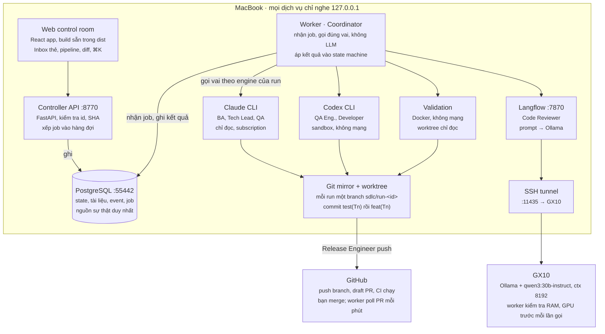
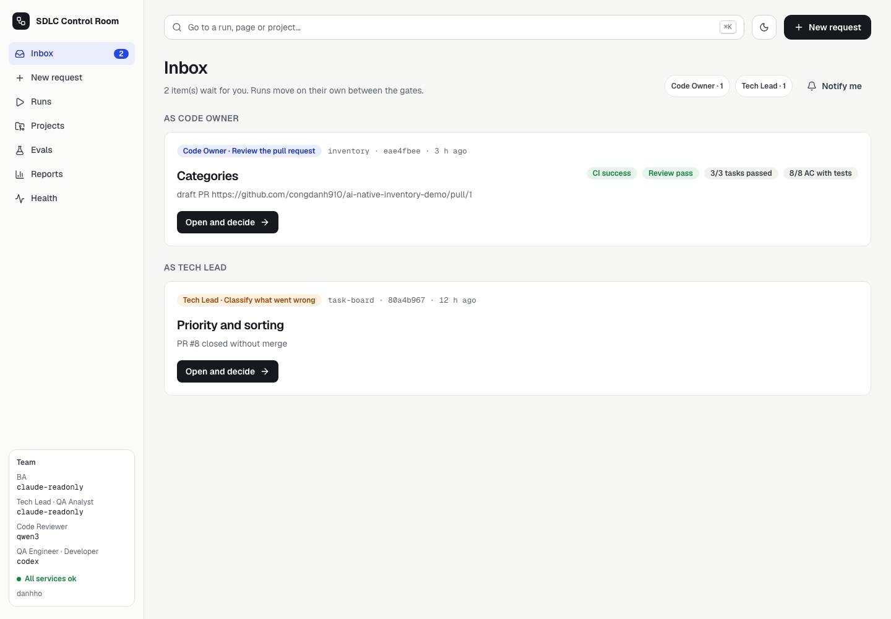
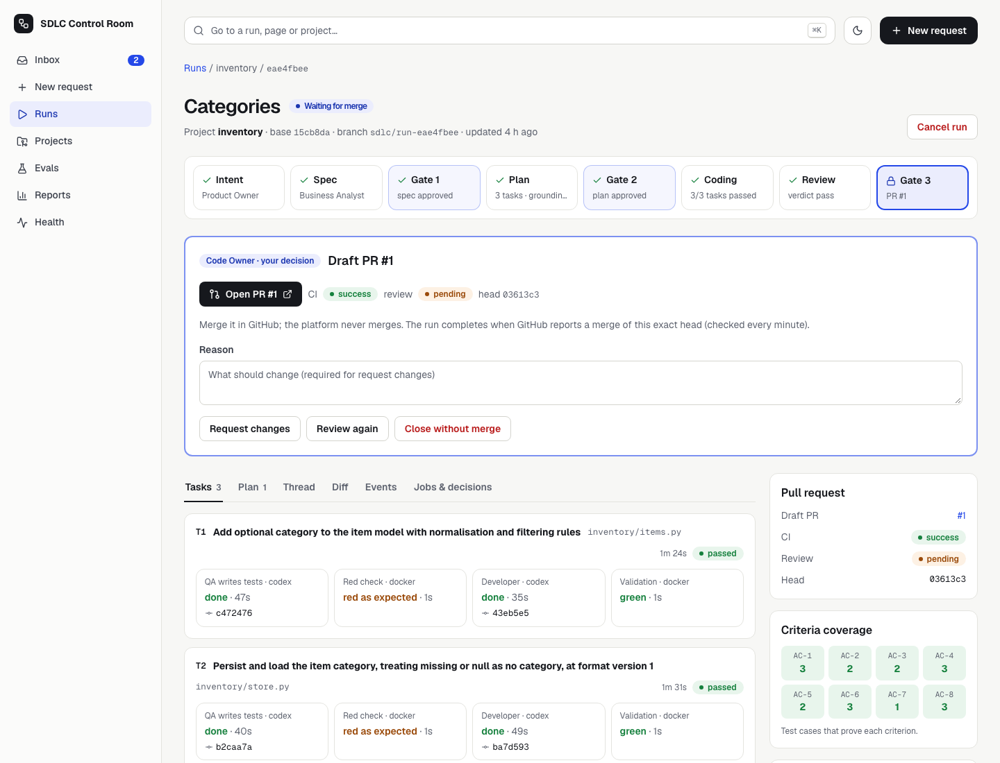

# Hướng dẫn dùng thử AI-native SDLC (Option B v3)

_Cập nhật 14/10/2026 · bản gốc: [trang Claude Docs](https://claude.ai/artifact/FMfNAm6VsrVbp1B6EJ3Gkx)_

Một đội phát triển gồm các vai AI nhận yêu cầu, viết spec, lập kế hoạch, viết test và code, rồi mở draft PR; người chỉ duyệt ở 3 cổng (spec, plan, merge). Hai dự án demo đã sẵn sàng để thử: `task-board` (Node) và `inventory` (Python).

## Đã xây gì

Sáu phase và control room mới đã xong, 144 test tự động pass; mã nguồn ở `poc-option-b/` trên branch `feature/option-b-v2` (draft PR #2).

| Phase | Nội dung | Kết quả |
| --- | --- | --- |
| B1 | Docker (PostgreSQL, Langflow), tunnel tới GX10, `sdlc up/down/doctor` | Môi trường chạy bằng một lệnh |
| B2 | Controller lưu trạng thái, web control room, Inbox, đội mock | Đi hết vòng lặp không cần model |
| B3 | Vai suy nghĩ trên Qwen3, grounding check, eval chỉ lập kế hoạch | Eval Task Board: 5/5 plan qua grounding |
| B4 | Codex viết test và code, validation trong container Docker, draft PR thật | PR #8 (task-board), PR #1 (inventory) |
| B5 | Huỷ run, dọn khi crash, hết hạn mức subscription, webhook GitHub | Lỗi được hoãn hoặc chuyển cho người, không chạy lại mù |
| B6 | Engine theo vai, dự án thứ hai (Python), báo cáo theo vai | BA, Tech Lead, QA Analyst chạy Claude chỉ đọc |
| UI | Control room mới bằng React: Inbox dạng thẻ, pipeline, ma trận độ phủ, diff, sáng/tối, ⌘K | Thay UI cũ, đủ mọi thao tác của người |

So sánh engine trên Task Board: Claude và Codex chỉ đọc đạt 5/5 plan qua grounding ngay lần đầu, Qwen3 đạt 3/5.

## Flow của một run

Bạn chỉ duyệt ở 3 cổng, mọi bước khác chạy tự động.

```mermaid
flowchart LR
  intent["Intent<br/><small>bạn viết yêu cầu</small>"] --> spec["Spec<br/><small>Business Analyst</small>"]
  spec --> g1{{"Cổng 1<br/>duyệt spec"}}
  g1 --> plan["Plan + tests<br/><small>kèm grounding</small>"]
  plan --> g2{{"Cổng 2<br/>duyệt plan"}}
  subgraph task["Mỗi task, theo thứ tự phụ thuộc"]
    direction LR
    qa["QA viết test<br/><small>Codex</small>"] --> red["Red check<br/><small>test phải trượt</small>"]
    red -- "đã pass sẵn: viết lại 1 lần" --> qa
    red --> dev["Developer<br/><small>Codex viết code</small>"]
    dev --> val["Validation<br/><small>Docker, mọi test</small>"]
    val -- "lỗi: sửa, tối đa 2 lần" --> dev
  end
  g2 --> qa
  val --> review["Code Reviewer<br/><small>Qwen3, review.md</small>"]
  review --> pr["Draft PR<br/><small>Release Engineer</small>"]
  pr --> g3{{"Cổng 3: merge<br/>GitHub, bởi bạn"}}
  g3 --> done["COMPLETED<br/><small>worker ghi nhận</small>"]
```



Bước nào lỗi, hoặc Developer báo `DISPUTE`: run dừng ở `NEEDS_HUMAN` và chờ bạn quyết định. Grounding trượt thì Tech Lead lập lại plan một lần trước khi tới Cổng 2; mỗi task được commit riêng (test rồi code) trên branch của run.

## Kiến trúc

Mọi thứ chạy trên MacBook trừ Qwen3 (GX10) và GitHub; worker là nơi duy nhất gọi các vai, còn PostgreSQL giữ trạng thái chính thức.



API không gọi vai trực tiếp: nó ghi quyết định và xếp job vào PostgreSQL, worker nhận job rồi gọi Claude, Codex, container hoặc Langflow theo engine của run.

### Thành phần

Mọi dịch vụ trên MacBook chỉ nghe ở `127.0.0.1`; `./sdlc up` bật tất cả, `./sdlc doctor` kiểm tra từng cái.

| Thành phần | Chạy ở đâu | Công nghệ | Cổng | Việc |
| --- | --- | --- | --- | --- |
| Web control room | Trình duyệt của bạn | React + TypeScript (Vite, Tailwind), build sẵn trong `controller/web/dist` | 8770 | Inbox dạng thẻ, pipeline của run, ma trận độ phủ, diff, Evals, Reports, ⌘K |
| Controller API | MacBook, tiến trình uvicorn | Python 3.12, FastAPI | 8770 | Nhận quyết định của người, kiểm tra version/SHA, đưa job vào hàng đợi |
| Worker (Delivery Coordinator) | MacBook, `python -m controller.app.worker` | Python, không LLM | – | Lấy job từ hàng đợi, gọi đúng vai, áp kết quả vào state machine, poll PR mỗi phút |
| Controller DB | Docker `controller-db` | PostgreSQL 16 | 55442 | Projects, runs, documents, plans, tasks, executions, approvals, events, evals |
| Langflow | Docker `langflow` (+ `langflow-db`) | Langflow 1.12 | 7870 | 5 flow, mỗi vai một flow: prompt → Ollama; prompt đồng bộ từ `langflow/prompts/` |
| SSH tunnel | MacBook → GX10 | `ssh -N -L` | 11435 → 11437 | Đưa Langflow tới Ollama trên GX10; tự mở lại khi rớt |
| Ollama + Qwen3 | GX10 | `qwen3:30b-instruct`, ctx 8192 | 11437 (nội bộ) | Code Reviewer; worker kiểm tra RAM/GPU trước mỗi lần gọi |
| Claude Code CLI (chỉ đọc) | MacBook | `claude -p`, subscription claude.ai | – | Business Analyst, Tech Lead, QA Analyst; chỉ Read/Glob/Grep trong worktree |
| Codex CLI | MacBook | `codex exec`, subscription ChatGPT | – | QA Engineer, Developer; sandbox `workspace-write`, không mạng |
| Validation container | Docker, mỗi lệnh một container | `node:20-alpine`, `python:3.12-slim`… | – | Red check và validation: không mạng, worktree chỉ đọc, 2 CPU, 2 GB |
| Git mirror + worktree | `.data/projects/<key>/mirror.git`, `.data/worktrees/<run>` | git | – | Repo đọc ở commit ghim; mỗi run một worktree trên branch `sdlc/run-<id>` |
| GitHub | github.com | `gh` của bạn | – | Push branch, draft PR, CI; webhook có chữ ký (tuỳ chọn) |

### Một job chạy thế nào

Mọi việc của đội là một dòng trong bảng `executions`; worker xử lý từng job một, nên run không bao giờ bị chạy song song trên cùng worktree.

1. **Xếp hàng**: API hoặc coordinator thêm job (`specify`, `plan`, `ground`, `code_task`, `review`, `release`) kèm idempotency key, nên cùng một việc không bị xếp hai lần.
2. **Nhận job**: worker lấy job bằng `FOR UPDATE SKIP LOCKED`, giữ lease 120 giây và gia hạn liên tục; cứ 5 giây kiểm tra run có bị huỷ không.
3. **Load** (đọc DB): dựng ngữ cảnh từ artifact đã lưu: intent, spec, policy, AGENTS.md, plan, engine của run, file và symbol của repo ở commit ghim.
4. **Compute** (không chạm DB): gọi vai — Claude hoặc Qwen3 cho vai suy nghĩ, Codex + container cho vai làm; đầu ra được chuẩn hoá và kiểm tra theo schema, sai thì hỏi lại tối đa 2 lần; bước *tidy* gỡ tiêu chí kiểu "test pass", file test trong task của Tech Lead.
5. **Apply** (một transaction): kiểm tra run vẫn ở đúng trạng thái và version, lưu tài liệu, chuyển trạng thái, ghi event, xếp job kế tiếp; run đã đổi thì kết quả bị bỏ (`discarded`).
6. **Khi lỗi**: job suy nghĩ được thử lại tối đa 3 lần (chờ 10, 20, 40 giây); GX10 bận → hoãn 2 phút; hết hạn mức subscription → hoãn 15 phút; job có tác dụng phụ (code, release) không bao giờ chạy lại mù mà chuyển run sang `NEEDS_HUMAN`.

Quyết định của người (duyệt spec, plan) phải nêu đúng id và SHA-256 của phiên bản đang xem; phiên bản cũ bị từ chối.

### Dữ liệu và an toàn

PostgreSQL giữ trạng thái chính thức; git giữ code và bản sao các tài liệu; file log nằm ở `.data/`.

| Lưu gì | Ở đâu |
| --- | --- |
| Trạng thái run/task, quyết định, nhật ký event, kết quả eval | PostgreSQL `controller-db` |
| intent, spec, plan, review, report (có SHA-256) | DB + commit trong `.sdlc/runs/<run>/` trên branch của run |
| Test và code của từng task | Commit `test(Tn)` / `feat(Tn)` trên branch `sdlc/run-<id>` |
| Log phiên CLI và log validation | `.data/logs/<run>/` |

Các lớp chặn, từ trong ra ngoài:

- **Trong phiên CLI**: Claude chỉ có Read/Glob/Grep (vai suy nghĩ) hoặc công cụ sửa file kèm hook chặn file ngoài phạm vi; Codex chạy sandbox không mạng; biến API key bị gỡ khỏi môi trường.
- **Sau phiên**: controller kiểm tra diff — QA chỉ được thêm test, không skip, không sửa dòng cũ (trừ mở rộng import); Developer chỉ sửa file của task, không đụng test. Vi phạm thì huỷ thay đổi, không commit.
- **Validation**: container không mạng, worktree chỉ đọc, giới hạn CPU, RAM, số tiến trình; chỉ chạy lệnh khai báo trong `.sdlc/project.yaml`.
- **Policy**: file bảo vệ (`.env`, `.github/`, `AGENTS.md`…) không ai được sửa; grounding chặn plan tham chiếu file hoặc hàm không tồn tại.
- **API**: chỉ nghe loopback, kiểm tra Host, mọi lệnh ghi cần header `X-SDLC-Client`; webhook GitHub cần chữ ký HMAC.
- **Release**: không tự merge; run chỉ `COMPLETED` khi GitHub báo merge đúng head đã push.

## Các vai và engine

Mỗi vai có hợp đồng riêng; engine của vai suy nghĩ đặt trong `.env` (`SDLC_ENGINES`) và được ghi cố định lên mỗi run lúc tạo.

| Vai | Làm gì | Engine |
| --- | --- | --- |
| Business Analyst | Viết spec: user story, tiêu chí AC-n, câu hỏi | Claude chỉ đọc (subscription) |
| Tech Lead | Viết plan: task, file sửa, phụ thuộc | Claude chỉ đọc |
| QA Analyst | Viết test plan: mỗi AC có test case | Claude chỉ đọc |
| QA Engineer | Viết test trước khi có code; chỉ được thêm test | Codex (subscription) |
| Developer | Viết code trong đúng file của task; không được sửa test | Codex |
| Validation Gate | Red check và validation | Container Docker, không mạng, chỉ đọc |
| Code Reviewer | Viết review.md (tham khảo) | Qwen3 trên GX10 |
| Release Engineer | Push branch, mở draft PR, theo dõi CI và merge | `gh` của bạn |

Nền tảng không tự merge, không deploy và không dùng API key trả phí.

## Giao diện

Control room là ứng dụng React (sáng/tối, ⌘K) theo [mockup đã duyệt](https://claude.ai/artifact/EdeSnqmM2HNHH4XjMN75Na); mọi việc chờ bạn nằm ở Inbox, mọi quyết định nằm ở đầu trang run. Chi tiết design: [ui-design.md](ui-design.md).





## Cách dùng thử

Từ máy trống tới draft PR đầu tiên mất khoảng 30–45 phút, phần lớn là chuẩn bị repo; sau đó mỗi tính năng 3 task mất khoảng 10–15 phút. Ví dụ dưới đây dùng repo Python nhỏ giống [`ai-native-inventory-demo`](https://github.com/congdanh910/ai-native-inventory-demo).

### Bước 0 — Chuẩn bị máy (một lần)

| Cần | Kiểm tra bằng |
| --- | --- |
| Docker Desktop đang chạy | `docker info` |
| uv (Python 3.12 được cài tự động) | `uv --version` |
| GitHub CLI đã đăng nhập, có quyền push repo của project | `gh auth status` |
| Codex CLI đăng nhập bằng ChatGPT (không dùng API key) | `codex login status` |
| Claude Code đăng nhập bằng claude.ai | `claude auth status` |
| SSH key tới GX10, Ollama có `qwen3:30b-instruct` | `ssh <user@gx10> ollama list` |

```bash
cd poc-option-b
./sdlc init --gx10-host user@gx10-host --gx10-port 22 --gx10-identity ~/.ssh/gx10
```

`init` tạo `.env`. Bật đội thật bằng ba dòng sau trong `.env`:

```bash
SDLC_TEAM_MODE=qwen3
SDLC_DOING_MODE=cli
SDLC_ENGINES=business_analyst=claude-readonly,tech_lead=claude-readonly,qa_analyst=claude-readonly
```

Rồi `./sdlc up` và `./sdlc doctor` (mọi dòng phải ✓, kể cả codex, claude, gh), mở http://127.0.0.1:8770.

### Bước 1 — Chuẩn bị repo của project

Repo cần: nằm trên GitHub; test chạy được bằng một lệnh, không cần mạng (cài thư viện thì đặt ở `setup`); stack có image sẵn (`node-20`, `node-22`, `python-3.12`, `python-3.13`); nhánh mặc định đang xanh.

Thêm bốn file ở gốc repo rồi commit lên nhánh mặc định:

| File | Nội dung |
| --- | --- |
| `AGENTS.md` | Kiến thức cho mọi vai AI, ngắn gọn khoảng một trang: lệnh test, cấu trúc (luật nghiệp vụ nằm ở module nào), quy ước, những gì không được đụng |
| `CLAUDE.md` | Chỉ một dòng `@AGENTS.md`, để Claude Code đọc cùng kiến thức |
| `REVIEW.md` (tuỳ chọn) | Thế nào là lỗi Important, thế nào là nit, cho Code Reviewer |
| `.sdlc/project.yaml` | Lệnh validation, đường dẫn được sửa, đường dẫn test, engine, giới hạn, chế độ từng stage |

Ví dụ `AGENTS.md` (rút gọn từ repo inventory):

```markdown
# Inventory
Command line stock keeping in Python 3.12, standard library only.

## Commands
- Test: `python -m unittest discover -s tests -t .`

## Structure
- `inventory/items.py`: pure item model. Every rule about items (validation, defaults, filtering, sorting) lives here.
- `inventory/store.py`: JSON persistence only. Old files must still load.
- `inventory/cli.py`: argparse wiring only.
- `tests/`: unittest tests.

## Never
- Modify `.github/`, `.sdlc/` or anything outside `inventory/` and `tests/`.
```

Ví dụ `.sdlc/project.yaml`:

```yaml
schema_version: 1
project: inventory                 # key khi thêm project ở bước 2
default_branch: main
validation_image: python-3.12      # node-20 | node-22 | python-3.12 | python-3.13
setup: []                          # ví dụ ["npm", "ci"]: chạy một lần, có mạng
validation:                        # chạy trong container, không mạng, repo chỉ đọc
  - name: unit-tests
    run: ["python", "-m", "unittest", "discover", "-s", "tests", "-t", "."]
    timeout_seconds: 300
  - name: compile
    run: ["python", "-X", "pycache_prefix=/tmp/pyc", "-m", "compileall", "-q", "inventory"]
paths:
  allowed: ["inventory/**"]        # Developer chỉ được sửa ở đây
  tests: ["tests/**"]              # QA Engineer chỉ được thêm test ở đây
  protected: ["AGENTS.md", "CLAUDE.md", "REVIEW.md", "pyproject.toml"]
testing:
  red_check: true                  # test mới phải trượt trước khi có code
context:
  include: ["inventory/**", "tests/**", "README.md", "pyproject.toml"]
executors: [codex, claude]
default_executor: codex            # Developer; thêm testing.qa_executor để QA dùng CLI khác
limits:
  max_tasks: 5
  max_changed_files: 8
stages:
  spec: gated                      # manual | gated | auto
  plan: gated                      # luôn có cổng duyệt
  coding: auto
  review: auto
```

### Bước 2 — Thêm project (vai Platform Admin)

Vào **Projects → Add a project**: **Key** bằng `project:` trong `project.yaml`, **Repository** là URL GitHub, **Branch** để trống nếu dùng nhánh mặc định. Nền tảng clone một mirror chỉ đọc rồi kiểm tra: đủ file onboarding, từng lệnh validation pass trong container trên đầu nhánh, và `gh` có quyền push. Project phải ở trạng thái **ready** thì mới gửi được request có viết code.

| Check báo lỗi | Cách sửa |
| --- | --- |
| `AGENTS.md` / `.sdlc/project.yaml` missing hoặc invalid | Commit file lên đúng nhánh, sửa theo dòng lỗi được báo |
| `project key` khác nhau | Key khi thêm project phải bằng `project:` |
| `validation image` không được hỗ trợ | Đổi `validation_image` sang một giá trị trong danh sách |
| `validation: <tên>` fail | Mở log được báo (trong `.data/logs/checks/`); thường do lệnh cần mạng, ghi file vào repo (repo chỉ đọc) hoặc test đang đỏ |
| `GitHub access` fail | `gh auth login` bằng tài khoản có quyền push repo |

Sửa xong thì push và bấm **Check again**.

### Bước 3 — Gửi request (vai Product Owner)

**New request** (nút đen ở góc trên bên phải): chọn project, điền Title, Problem, Desired outcome (mỗi dòng một tiêu chí), hoặc viết tự do ở khung **Draft with AI** bên phải rồi sửa lại. Ví dụ: `list --search TEXT` tìm theo SKU hoặc tên, không phân biệt hoa thường. Bấm **Submit intent.md**.

### Bước 4 — Duyệt spec (Cổng 1)

**Inbox** hiện thẻ "Review spec.md" sau khoảng 1 phút; bấm **Open and decide**. Khối quyết định ở đầu trang run hiện spec.md: kiểm tra các AC, rồi **Accept**, **Edit** (lưu phiên bản mới) hoặc **Reject**. Nếu Business Analyst có câu hỏi chặn, trả lời ở đây trước.

### Bước 5 — Duyệt plan (Cổng 2)

Sau 1–3 phút có thẻ "Review the plan". Xem ma trận tiêu chí × task × test case: mỗi AC phải có ít nhất một task và một test; dòng vàng là case `expected pass` (chỉ hợp lệ khi test đó pass trên code hiện tại); đọc cảnh báo grounding (ví dụ sửa markup mà không sửa stylesheet), rồi **Approve plan**.

### Bước 6 — Theo dõi phần code

Không cần làm gì. Thanh pipeline 8 chặng ở đầu trang; tab **Tasks** là dòng thời gian từng task: QA viết test → red check (test phải trượt) → Developer viết code → validation (phải xanh), kèm CLI, commit, thời gian và lý do nếu bị từ chối. Tab **Diff** cho xem code thay đổi; **Thread**, **Events**, **Jobs & decisions** cho xem chi tiết.

### Bước 7 — Khi run dừng ở NEEDS_HUMAN

Đọc lý do trong khung đỏ. Developer báo tranh chấp test → **Let QA update the tests** (QA được sửa test cũ, có ghi trong PR) hoặc **Keep the tests**; trường hợp khác → **Resume**, **Replan** hoặc **Cancel run**, kèm lý do.

### Bước 8 — Merge (Cổng 3)

Khi có thẻ "Review the pull request": bấm **Open PR**, xem code và CI trên GitHub, rồi merge. Worker thấy merge trong vòng 1 phút và đóng run thành `COMPLETED`. Muốn đội sửa tiếp → **Request changes**; review lại → **Review again**; bỏ → **Close without merge**.

### Bước 9 (tuỳ chọn) — Eval cho project

Để đo khi đổi prompt hay engine: tạo `evals/<suite>/` với `suite.yaml` (project, commit ghim), các file tính năng trong `features/` và plan mẫu trong `golden/` (xem `evals/inventory/`), rồi chạy ở **Evals**, chọn engine cho từng vai. Kết quả và mức dùng theo vai xem ở **Reports**.

Tắt: `./sdlc down` (dữ liệu vẫn giữ). Mẹo: ⌘K để nhảy tới run hoặc trang bất kỳ; nút mặt trăng đổi sáng/tối.

## Lưu ý và giới hạn

- Branch `sdlc/run-xxxx` của mỗi run được push lên repo demo; PR #1 trên `inventory-demo` đang chờ quyết định merge hoặc đóng.
- Sửa `.env` thì chạy lại `./sdlc up`; run đã tạo vẫn giữ engine cũ.
- Không restart dịch vụ khi run đang ở `CODING`: task đang chạy sẽ thành `UNKNOWN` và phải Resume.
- Các vai dùng Claude gửi nội dung repo tới Anthropic qua subscription; Code Reviewer dùng GX10.
- Code Reviewer (Qwen3) chưa bắt được lỗi kiến trúc; vẫn cần người đọc PR.
- Plan mẫu của bộ eval `inventory` do Claude viết, chưa có người duyệt.
- Chữ trên giao diện là tiếng Anh, khớp với thông báo của backend. Dùng thử không cần Node; chỉ khi sửa giao diện mới chạy `cd frontend && npm ci && npm run build`.
- Tài liệu chi tiết: [user-guide.md](user-guide.md); sự cố và cách xử lý: [runbook.md](runbook.md).
