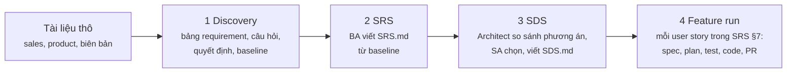

# Hướng dẫn sử dụng AI-Native SDLC

_Cập nhật 17/10/2026 · áp dụng cho branch `feature/option-b-v2`_

AI-Native SDLC là một đội phát triển phần mềm gồm các vai AI (Business Analyst, Architect, Tech Lead, QA, Developer, Code Reviewer) làm theo quy trình AIF-SDLC của công ty. Người duyệt ở mọi cổng: không bước nào tự merge hay deploy. Mọi thao tác làm trên **control room** tại http://127.0.0.1:8770; dòng lệnh chỉ dùng để bật, tắt và kiểm tra hệ thống.

## 1. Toàn cảnh

Một dự án đi qua bốn loại run, theo thứ tự:



| Run | Đầu vào | Kết quả trong repo | Cổng người duyệt |
|---|---|---|---|
| Discovery | File thô (PDF, DOCX, XLSX, PPTX, ảnh, văn bản dán) | `requirements/` (bảng requirement, câu hỏi, quyết định, baseline, file thô) | Baseline (PO), PR |
| SRS | Baseline đã merge, hoặc brief gõ tay | `SRS.md` | SRS (PO), PR |
| SDS | `SRS.md` đã merge + brief kiến trúc | `SDS.md` | Options (SA), SDS (Tech Lead), PR |
| Feature | Một user story của SRS §7 | `specs/NNN-slug/`, test, code | Spec (PO), Plan (TL), Test cases (QC), PR (Code Owner) |

Mỗi run kết thúc bằng một **draft PR**. Merge PR trên GitHub xong thì **không cần làm gì thêm**: trong vòng khoảng 1 phút, worker thấy PR đã merge, đóng run thành COMPLETED và **tự kiểm tra lại dự án**. Trang Projects và danh sách user story ở form Feature request nhờ đó được cập nhật. Khi tạo run mới, nếu nhánh mặc định vẫn đi trước lần kiểm tra cuối (ví dụ có người push thẳng lên `main`), platform kiểm tra lại thêm lần nữa. **Projects → Check again** chỉ cần khi anh sửa repo bằng tay và muốn xem kết quả ngay. Dự án nhỏ không có tài liệu thô thì bỏ qua Discovery và viết SRS từ brief.

## 2. Các vai

**Vai người.** Hiện một operator giữ mọi vai; mỗi quyết định ghi lại "thay mặt vai nào".

| Vai | Duyệt gì |
|---|---|
| Product Owner (PO) | Baseline của Discovery, SRS, spec của user story; trả lời câu hỏi về phạm vi |
| Solution Architect (SA) | Chọn phương án kiến trúc ở bước Options của SDS |
| Tech Lead | SDS, plan; xử lý run dừng ở `NEEDS_HUMAN` |
| QC | Test cases (cổng Quality) |
| Code Owner | Pull request |
| Platform Admin | Thêm dự án, kiểm tra onboarding |

Discovery có thêm vai trả lời câu hỏi theo cấu hình dự án: mặc định PO, BA, SA, TA (Technical Architect), QC, DPO (bảo vệ dữ liệu) và Sales (đầu mối khách hàng).

**Vai AI.**

| Vai | Làm gì | Engine mặc định |
|---|---|---|
| Business Analyst | Discovery: đọc nguồn, lập bảng requirement, đặt câu hỏi, đọc biên bản. SRS. Spec của user story | Claude (chỉ đọc). Discovery: theo `SDLC_DISCOVERY_ENGINE` (hiện là Codex) |
| Architect | So sánh phương án kiến trúc, viết SDS | Engine của Tech Lead |
| Tech Lead | Plan: task, file sửa, thứ tự | Claude (chỉ đọc) |
| QA Analyst | Test cases cho từng AC/EC | Claude (chỉ đọc) |
| QA Engineer, Developer | Viết test trước, rồi viết code | Codex |
| Validation Gate | Chạy test trong container không mạng | Docker |
| Code Reviewer | `review.md` (tham khảo) | Claude (chỉ đọc) |
| Release Engineer | Push branch, mở draft PR, theo dõi merge | `gh` của bạn |

## 3. Cài đặt và vận hành

**Cần có trên máy (một lần).**

| Cần | Kiểm tra |
|---|---|
| Docker Desktop đang chạy | `docker info` |
| uv | `uv --version` |
| GitHub CLI đã đăng nhập, có quyền push repo dự án | `gh auth status` |
| Claude Code đăng nhập bằng claude.ai | `claude auth status` |
| Codex CLI đăng nhập bằng ChatGPT | `codex login status` |
| `pdftotext` (để Codex đọc PDF) | `pdftotext -v` (cài: `brew install poppler`) |

**Lệnh.** Chạy trong `poc-option-b/`:

| Lệnh | Việc |
|---|---|
| `./sdlc init` | Tạo `.env` lần đầu |
| `./sdlc up` | Bật database, API, worker; in địa chỉ control room |
| `./sdlc down` | Tắt mọi thứ; dữ liệu vẫn giữ |
| `./sdlc doctor` | Kiểm tra từng thành phần, CLI đã đăng nhập chưa |
| `./sdlc logs api` / `worker` | Xem log |

**Cấu hình chính trong `.env`.** Danh sách đầy đủ và giá trị mặc định ở `.env.example`.

| Khoá | Giá trị đang dùng | Ý nghĩa |
|---|---|---|
| `SDLC_TEAM_MODE` | `codex-readonly` (từ 17/10, hết hạn mức Claude) | Engine cơ bản của các vai suy nghĩ, cả nút Draft with AI |
| `SDLC_ENGINES` | mọi vai `codex-readonly` | Engine từng vai: `business_analyst`, `tech_lead`, `qa_analyst`, `code_reviewer` |
| `SDLC_DISCOVERY_ENGINE` | `codex-readonly` | BA của run Discovery, khi khác `SDLC_ENGINES`; để trống thì dùng như các run khác |
| `SDLC_DOING_MODE` | `cli` | Codex/Claude viết test và code thật (`mock` để thử không gọi AI) |
| `SDLC_QWEN_ENABLED` | `false` | Qwen trên GX10 đã tắt |
| `SDLC_KEEP_AWAKE` | `true` | Giữ Mac không ngủ khi có job (macOS) |

Lưu ý khi vận hành:
- Sửa `.env` thì chạy `./sdlc down && ./sdlc up`. Engine được ghim vào mỗi run lúc tạo, nên run đang mở giữ engine cũ.
- **Không khởi động lại khi có job đang chạy** (run ở `EXTRACTING`, `SPECIFYING`, `DESIGNING_OPTIONS`, `CODING`…): job đó mất và phải chạy lại. Xem tab **Runs** trước.
- Máy ngủ thì job dừng theo. Worker tự giữ máy thức khi có job, nhưng gập máy vẫn làm máy ngủ.

**Chi phí.** AI chạy qua subscription Claude và ChatGPT bằng CLI, không dùng API key, nên **không phát sinh tiền**. Con số "$" trong log và trang Reports chỉ là ước tính theo giá API. Thứ bị tiêu là **hạn mức** của gói (theo khung 5 giờ và theo tuần). Hết hạn mức thì job tự hoãn 15 phút rồi chạy lại.

## 4. Thêm dự án (Platform Admin)

Repo của dự án cần bốn file ở gốc, commit lên nhánh mặc định:

| File | Nội dung |
|---|---|
| `AGENTS.md` | Kiến thức cho mọi vai AI: lệnh test, cấu trúc, quy ước, những gì không được đụng |
| `CLAUDE.md` | Một dòng `@AGENTS.md` |
| `REVIEW.md` (tuỳ chọn) | Thế nào là lỗi quan trọng, thế nào là góp ý nhỏ, cho Code Reviewer |
| `.sdlc/project.yaml` | Lệnh validation, đường dẫn được sửa, đường dẫn test, giới hạn, chế độ từng stage, cấu hình Discovery |

Ví dụ `.sdlc/project.yaml` rút gọn:

```yaml
schema_version: 1
project: attendance              # phải trùng key khi thêm dự án
default_branch: main
validation_image: node-20        # node-20 | node-22 | python-3.12 | python-3.13
validation:
  - name: unit-tests
    run: ["node", "--test"]
paths:
  allowed: ["src/**", "package.json"]   # Developer chỉ sửa ở đây
  tests: ["test/**"]                    # QA Engineer chỉ thêm test ở đây
  protected: ["AGENTS.md", "CLAUDE.md", "REVIEW.md"]
default_executor: codex
limits:
  max_tasks: 5
  thinking_timeout_minutes: 20   # một lần gọi vai suy nghĩ; tài liệu dày cần lâu hơn
stages:
  spec: gated
  plan: gated
  options: gated                 # bước Options của SDS; "skip" để bỏ
discovery:                       # bỏ trống thì dùng mặc định
  commit_sources: true           # file thô vào requirements/sources/
  limits:
    max_rounds: 10
```

Vào **Projects → Add a project**: nhập **Key** (bằng `project:`) và URL repo GitHub. Nền tảng clone một bản mirror, kiểm tra file onboarding, chạy từng lệnh validation trong container, và kiểm quyền push. Dự án phải ở trạng thái **ready**. Có dòng báo lỗi thì sửa trong repo, push rồi bấm **Check again**.

## 5. Discovery: từ tài liệu thô tới baseline

### 5.1 Tạo discovery và thêm nguồn

1. **New request → tab Discovery**: chọn dự án, nhập tên (và ghi chú nếu có), bấm **Start discovery, then add sources**. Mỗi dự án chỉ có một discovery mở tại một thời điểm.
2. Trang run tự mở tab **Sources** (hoặc bấm **Add files** ở panel phía trên):
   - Kéo thả file vào khung, hoặc bấm vào khung để chọn. Nhận PDF, DOCX, XLSX, PPTX, PNG/JPG/WEBP, MD, TXT, CSV, EML; tối đa 50 MB và 300 trang mỗi file.
   - **Paste text** để dán email, chat, ghi chú.
   - Tick **These are minutes of a meeting** trước khi thêm nếu đó là biên bản họp: BA sẽ rút *quyết định* thay vì requirement.
   - Mỗi file lưu kèm SHA-256. **Remove** cần lý do; file vẫn giữ lại để kiểm tra sau.
3. Bấm **Start extraction**. BA đọc mỗi lượt 10 trang PDF (hoặc 30.000 ký tự văn bản), sau đó một lượt **consolidate** gộp mục trùng, gắn function vào feature và đặt câu hỏi cần đọc cả bộ mới thấy. Tiến độ xem ở tab **Jobs, logs & decisions**.

Thời gian tham khảo: khoảng 5–7 phút cho 10 trang trên Claude, khoảng 1,5 phút cho 2 trang trên Codex, cộng 1–4 phút cho lượt consolidate.

### 5.2 Đọc kết quả

| Tab | Có gì |
|---|---|
| **Requirements** | Bảng requirement gom theo loại (Goals, Actors, Permissions, Features, Functions, Rules, Data, Integrations, NFR…). Mỗi mục có REQ id, nội dung, thuộc feature hay actor nào, giai đoạn, và nguồn dạng `p. 7`: bấm vào là mở đúng trang PDF. Lọc theo loại, tìm kiếm, chọn phiên bản |
| **Questions** | Câu hỏi Q-001… gom theo vai trả lời; chặn (blocking) hay không |
| **Decisions** | Quyết định D-001…: từ câu trả lời, từ biên bản, hoặc ghi trực tiếp |
| **Thread** | `inventory.md`, `questions.md`, `decisions.md`, `baseline.md` theo phiên bản; thu gọn từng khối được |

Bảng requirement dùng một schema chung cho mọi dự án (15 loại mục). BA chỉ lấy requirement của **sản phẩm**; phần tài liệu nói về chính nó (mục đích bản tài liệu, người soạn, mẫu) không thành mục. Thiếu thông tin thì BA đặt câu hỏi, không tự điền.

### 5.3 Làm rõ: câu hỏi và quyết định

Trên tab **Questions**, với mỗi câu:
- **Suggested answer**: câu trả lời BA gợi ý kèm căn cứ (slide, trang, hoặc "thông lệ"). Bấm **Use as answer** để điền vào ô trả lời, sửa nếu cần rồi bấm **Answer**. BA không có căn cứ thì không gợi ý; gợi ý chỉ lặp lại câu hỏi hay ra lệnh ("Xác định…", "Cung cấp…") bị controller bỏ đi. Câu hỏi mở chưa có gợi ý sẽ được gợi ý ở lượt **Check the inventory again** hoặc **Extract again** sau.
- **Answer**: gõ câu trả lời. Nếu là ý của khách hàng thì ghi rõ "từ khách hàng, qua Sales". Câu trả lời tự thành một quyết định.
- **Defer**: hoãn sang sau, kèm lý do. Câu hoãn không chặn baseline và được ghi vào baseline.
- **Withdraw**: rút câu hỏi không còn đúng, kèm lý do.
- **Move to…**: chuyển cho vai khác.
- **Workshop list**: tải danh sách câu hỏi đang mở của một vai (hoặc tất cả), để mang vào buổi họp.

Inbox có thẻ **Questions for you** cho từng vai còn câu hỏi mở.

BA chia câu hỏi làm hai mức:
- **Baseline:** cần chốt mới xác định được phạm vi, actor và quyền, luồng chính, luật nghiệp vụ khách hàng quyết, tích hợp, pháp lý. Những câu này hiện trong tab Questions để trả lời.
- **Later:** chi tiết để SRS, SDS hoặc spec của từng story quyết, như thời gian chính xác, danh sách trường, hành vi màn hình, thông số kỹ thuật. Controller **tự hoãn** các câu này với lý do "for the SRS, SDS or a story's spec to settle"; chúng vào baseline ở mục câu hỏi hoãn, và run SRS nhận lại. Muốn xem thì tick **show answered, deferred, withdrawn**; muốn trả lời ngay thì bấm **Open again**.

Sau vòng đầu, BA chỉ hỏi thêm về những gì *mới*: nguồn hay biên bản mới, hoặc một quyết định mâu thuẫn với mục hay quyết định khác. BA không hỏi sâu thêm vào chi tiết của một câu đã trả lời.

Trên tab **Decisions**:
- **Record a decision**: ghi quyết định trực tiếp, kèm REQ id. Chọn **Effect** để controller áp đúng như ghi: *Confirm the items*, *Put the items out of scope*, hoặc *Change the item text* (kèm nội dung mới). Không chọn effect thì BA tự đọc quyết định ở vòng sau.
- Quyết định BA rút từ biên bản ở trạng thái **proposed**: vai sở hữu bấm **Accept** hoặc **Reject**. Accept thì câu hỏi liên quan được đánh dấu đã trả lời.

### 5.4 Extract again và giới hạn số vòng

- **Extract again**: chỉ đọc nguồn và biên bản **mới**, rồi áp các quyết định đã duyệt. REQ id không đổi giữa các vòng. Không có gì mới thì nút bị từ chối, để khỏi tốn hạn mức.
- **Check the inventory again**: chỉ chạy lượt consolidate, không đọc nguồn, khi muốn BA kiểm lại toàn bộ bảng (gắn function vào feature, gộp mục trùng, gợi ý câu trả lời). Lượt này chỉ đặt câu hỏi khi thấy mâu thuẫn, và **không tính vào số vòng**.
- Mặc định tối đa **10 vòng** có nội dung mới (`discovery.limits.max_rounds`). Hết số vòng thì panel hiện ô **Why another round**: PO ghi lý do rồi bấm **Confirm another round**. Mỗi vòng vượt giới hạn được ghi thành event.

### 5.5 Chốt baseline

1. Mở **Prepare the baseline (Product Owner)** trong panel, ghi **Scope of this phase** (phạm vi đã thoả thuận với khách hàng), bấm **Prepare baseline**.
2. Ở cổng baseline có checklist:
   - **Controller tự kiểm, trượt thì không duyệt được:** không còn câu hỏi chặn hay câu mâu thuẫn đang mở; không còn quyết định chờ duyệt; bảng đã áp mọi quyết định (nếu chưa thì Extract again); mọi mục có nguồn hoặc quyết định; mỗi feature trong phạm vi có ít nhất một function, và mỗi function thuộc một feature.
   - **Cảnh báo của BA:** NFR chưa có con số. Mục này không chặn, vì NFR định tính như "mã hoá dữ liệu" vốn không có số.
   - **PO tick:** phạm vi đúng với thoả thuận; các mục ngoài phạm vi và câu hoãn chấp nhận được; danh sách actor và quyền đã đủ.
3. **Approve baseline**: platform commit `requirements/` lên branch của run (`baseline.md`, `baseline.json`, `inventory.md`, `questions.md`, `decisions.md`, `sources.md`, `sources/`) rồi mở draft PR. **Back to clarifying** để quay lại sửa.
4. Merge PR trên GitHub; worker ghi nhận trong vòng 1 phút và đóng run Discovery. Sau đó vào **Projects → Check again**.

## 6. SRS

1. **New request → Project SRS**. Có baseline thì tick **Build on the discovery baseline**: chỉ cần tên sản phẩm, ghi chú tuỳ chọn. Không có baseline thì điền brief: tóm tắt, users và roles, feature mong muốn, ràng buộc.
2. BA viết `SRS.md` theo khung công ty (§1–§8). Khi dựng từ baseline, mỗi FR, user story, rule, role… ghi lại REQ mà nó lấy từ đó, và SRS có thêm **Appendix A. Requirement traceability**.
3. Ở cổng SRS, controller kiểm: đủ các mục §1–§8, story id không trùng, và mọi REQ trong phạm vi đều được dùng; mục `option` để dành cho SDS. PO tick 3 mục rồi **Accept** (hoặc **Edit**, **Reject**). Run mở draft PR; merge rồi **Check again**.

Nếu baseline chưa merge, run dừng ở `NEEDS_HUMAN` với lý do "merge the discovery pull request first".

### Khi SRS (hoặc SDS) chưa đạt

| Tình huống | Làm gì |
|---|---|
| Sai ít, anh tự sửa được | **Edit** ở cổng, sửa Markdown, **Save as new version**. Controller kiểm lại khung và truy vết; bản sửa ghi là của người |
| Cần AI viết lại theo góp ý | Ghi rõ cần đổi gì vào ô **Reason**, bấm **Reject: rewrite**. BA (hoặc Architect) nhận **bản nháp mới nhất cùng góp ý**, sửa đúng chỗ, giữ nguyên ID, rồi cổng duyệt lại |
| Đã qua cổng, mở PR rồi mới thấy sai | Ở panel PR, ghi lý do rồi bấm **Request changes**. Run quay về bước viết tài liệu như trên; duyệt xong thì **cùng PR đó** được cập nhật |
| Sai từ gốc requirement (thiếu, sai phạm vi) | Sửa ở Discovery: bổ sung nguồn hoặc quyết định trong một discovery mới, chốt baseline mới, merge, rồi chạy lại SRS từ baseline đó |
| Không cần nữa | **Reject: cancel run**, hoặc **Close without merge** ở bước PR |

Ở bước PR của **Discovery**, **Request changes** đưa run về Clarifying; lần chốt baseline sau sẽ cập nhật cùng PR đó.

## 7. SDS và bước Options

1. **New request → Project SDS** (cần `SRS.md` đã merge). Ô **Let the Architect propose the stack** được tick sẵn: chỉ cần tên sản phẩm. Ô Stack, Deployment, Integrations thành tuỳ chọn; điều gì anh điền vào đó là **ràng buộc** mà mọi phương án phải theo (ví dụ "bắt buộc PostgreSQL", "chạy trong mạng nội bộ"). Bỏ tick thì phải tự điền stack như cách cũ.
2. **Options** (bật mặc định): Architect so sánh 2–4 phương án kiến trúc, gồm mọi phương án có trong baseline cộng phương án tự đề xuất. Mỗi phương án có **stack theo từng lớp** (frontend, backend, database, AI, hạ tầng, giám sát…) kèm lý do, **deployment** và **tích hợp**. Tất cả suy ra từ SRS, baseline và stack hiện có của repo (`AGENTS.md`). Mỗi phương án được đánh giá theo NFR, chi phí, rủi ro, nơi lưu dữ liệu nhạy cảm, vận hành, kèm phương án Architect khuyến nghị.
3. Cổng Options (vai SA): đọc bảng so sánh và bảng stack của từng phương án, rồi chọn phương án.
   - Ghi **Adjustments to the chosen option** nếu muốn bổ sung hoặc sửa, ví dụ "dùng PostgreSQL thay MySQL; thêm Redis cho hàng đợi". Architect phải áp đúng các điều chỉnh này.
   - Ghi **Why this option** (bắt buộc), tick checklist rồi bấm **Choose PAx**.
   - Muốn Architect so sánh lại với góp ý thì ghi lý do rồi bấm **Ask for other options**.
4. Architect viết `SDS.md` (§1–§13) theo stack của phương án đã chọn cộng các điều chỉnh; mục §9.1 "Architecture Option" ghi phương án đã chọn, lý do của SA, các điều chỉnh và các phương án đã cân nhắc. Ở cổng SDS (Tech Lead), controller kiểm thêm rằng dòng Decision của §9 có ghi phương án đã chọn. Duyệt, merge PR, **Check again**.

Muốn bỏ bước Options thì đặt `stages.options: skip` trong `.sdlc/project.yaml`.

## 8. Feature run (một user story)

1. **New request → Feature request**: chọn dự án và **User story** trong SRS §7, điền Desired outcome, bấm **Submit intent.md**.
2. **Cổng Spec (PO):** BA viết AC-01… và EC-01… dạng Given/When/Then. Xem checklist, tick, **Accept**.
3. **Cổng Plan (Tech Lead):** task, file sửa, ma trận tiêu chí × task × test case, kết quả grounding (plan không được nhắc tới file hay hàm không tồn tại). **Approve plan**.
4. **Cổng Quality (QC):** `test_cases.md` và phân tích chéo. **Approve** thì bắt đầu viết code.
5. **Code (tự động):** với mỗi task, QA Engineer viết test, red check (test phải trượt), Developer viết code, validation trong container (phải pass). Theo dõi ở tab **Tasks** và **Diff**.
6. **Cổng PR (Code Owner):** `review.md` của Code Reviewer chỉ để tham khảo. Tick checklist, mở PR trên GitHub, merge. Run thành `COMPLETED`.

Developer báo test sai (`DISPUTE`), hoặc một bước lỗi, thì run dừng ở `NEEDS_HUMAN`: chọn **Let QA update the tests**, **Keep the tests**, **Resume**, **Replan** hoặc **Cancel run**, kèm lý do.

### Khi một cổng chưa đạt (mọi loại run)

Ở cổng nào cũng có ba hướng: **tự sửa** (Edit, lưu thành phiên bản mới của người), **yêu cầu AI làm lại** (Reject kèm lý do), hoặc **huỷ**. Lý do anh ghi được gửi nguyên văn cho vai AI ở lần làm lại, cùng bản nháp trước của nó, để nó sửa đúng chỗ và giữ nguyên ID.

| Cổng | Tự sửa | Yêu cầu AI làm lại | Ai nhận góp ý |
|---|---|---|---|
| Baseline (Discovery) | Ghi quyết định ở tab Decisions, rồi Extract again | **Back to clarifying** | BA, qua quyết định |
| SRS / SDS | **Edit** → Save as new version | **Reject: rewrite**; sau khi đã mở PR: **Request changes** | BA / Architect, kèm bản nháp mới nhất |
| Options (SDS) | Chọn phương án và ghi lý do | **Ask for other options** | Architect |
| Spec (feature) | **Edit** | **Reject: rewrite** | BA, kèm spec trước |
| Plan | **Edit** (JSON) | **Reject: replan** | Tech Lead |
| Test cases (Quality) | **Edit JSON** | **Reject: redesign tests**, hoặc **Reject: replan** | QA Analyst, hoặc Tech Lead |
| PR (feature) | Sửa trên GitHub | **Request changes** (đội sửa code tiếp) hoặc **Review again** | Developer, Code Reviewer |

**Viết góp ý thế nào cho hiệu quả:** nêu *cái gì sai*, *ở đâu* và *muốn thành thế nào*. Ví dụ: *"Tách story Check-in và Check-out thành 2 story; bỏ yêu cầu xuất Excel khỏi §3 vì REQ-045 đã ngoài phạm vi"* hiệu quả hơn nhiều so với *"chưa đúng"*. Mỗi ý một dòng; dẫn REQ id, AC id hay số mục SRS khi có thể. Góp ý của mọi lần làm lại trước vẫn được gửi kèm, nên không cần nhắc lại.

## 9. Các trang của control room

| Trang | Dùng để |
|---|---|
| **Inbox** | Mọi việc đang chờ người, theo vai; bấm **Open and decide** |
| **New request** | Tạo Feature, Discovery, Project SRS, Project SDS |
| **Runs** | Danh sách run, lọc theo dự án. Trên trang một run, bấm tên dự án ở breadcrumb để xem các run của dự án đó |
| **Projects** | Thêm dự án, xem kết quả kiểm tra onboarding, **Check again** sau mỗi lần merge |
| **Reports** | Số lần gọi, thời gian, mức dùng (ước tính giá API) theo vai và engine |
| **Evals** | Kiểm tra hồi quy cho vai suy nghĩ trên bộ đề cố định trong `evals/`, chỉ tới bước plan. Hiện cần đăng ký lại dự án `inventory`/`task-board` và chọn engine Claude (ô mặc định còn ghi `qwen3`); xem `docs/BACKLOG.md` |
| **Health** | Trạng thái database, migration, worker |

Trang một run gồm: thanh pipeline, panel **your decision** (việc đang chờ bạn), các tab nội dung, và khung bên phải (PR, base commit, branch, engine). Mẹo: ⌘K để nhảy tới run hay trang bất kỳ; nút mặt trăng đổi giao diện sáng/tối.

## 10. Engine và hạn mức

- Hết hạn mức Claude: đặt `SDLC_DISCOVERY_ENGINE=codex-readonly` để Discovery chạy bằng Codex. Muốn đổi cả vai khác thì sửa `SDLC_ENGINES`, `SDLC_DEFAULT_ENGINE` và `SDLC_TEAM_MODE`. Sau đó `./sdlc down && ./sdlc up`. Từ 17/10 mọi vai đang chạy Codex; quay lại Claude thì đặt ba khoá đó về `claude-readonly`.
- Codex đọc PDF qua `pdftotext` (mỗi dòng gắn `[page N]`, nên vẫn trích được trang). Codex **không đọc được ảnh và PDF scan**: gặp loại đó job sẽ dừng và báo lý do. Codex chỉ nhận chữ nên đọc bảng, sơ đồ kém hơn Claude, và tách mục chi tiết hơn.
- Run đang mở giữ engine lúc tạo. Muốn đổi engine của run đang mở thì hiện phải nhờ người vận hành (xem `docs/BACKLOG.md`, mục 2.6).

## 11. Prompt: xem và tuỳ chỉnh

**AI nhận được gì.** Mỗi lần gọi AI gửi một prompt gồm hai phần:
1. **Hướng dẫn của vai**: file `langflow/prompts/<vai>.md` trong repo nền tảng (ví dụ `extract.md`, `consolidate.md`, `srs.md`, `options.md`), cộng `common.md`.
2. **Dữ liệu JSON của đúng run đó**: bảng requirement, câu hỏi, quyết định, SRS… Kiến thức của dự án (`AGENTS.md`, `.specify/memory/constitution.md`, `REVIEW.md`) nằm trong phần JSON này.

**Xem prompt.** Tab **Jobs, logs & decisions** → nút **Prompt** trên dòng của job. Mỗi lần gọi trong job (từng lượt đọc, lượt consolidate, mỗi lần thử lại) là một prompt, xem được nguyên văn và **Copy** được. Mã **prompt version** (hash của hướng dẫn) cho biết run đã chạy bản hướng dẫn nào. Job chạy trước ngày 17/10/2026 chưa lưu prompt.

**Tuỳ chỉnh.** Hệ thống chia hai lớp, giống cách Claude Code (`CLAUDE.md`), Codex (`AGENTS.md`), GitHub Copilot (`.github/copilot-instructions.md`) hay spec-kit (`constitution.md`) đang làm:

| Lớp | Ai sửa | Sửa ở đâu | Áp cho |
|---|---|---|---|
| Kiến thức và luật của dự án | Đội dự án, qua PR | `AGENTS.md`, `.specify/memory/constitution.md`, `REVIEW.md` trong repo dự án | Mọi vai, chỉ dự án đó |
| Hướng dẫn lõi của từng vai | Đội nền tảng | `langflow/prompts/*.md` trong repo nền tảng | Mọi dự án |

- Muốn AI dùng đúng thuật ngữ, vai, quy ước hay luật nghiệp vụ của dự án: ghi vào `AGENTS.md` hoặc `constitution.md` của dự án. Đây là cách nên dùng.
- Hướng dẫn lõi quy định định dạng đầu ra (JSON theo schema mà controller kiểm), quy tắc trích nguồn và an toàn. Sửa sai một dòng có thể làm hỏng mọi run, nên không sửa trên giao diện. Sửa trong repo nền tảng, rồi kiểm bằng Evals trước khi dùng.
- Chưa có hướng dẫn riêng *theo vai* cho từng dự án (ví dụ thêm lưu ý chỉ cho BA của một dự án): xem `docs/BACKLOG.md`, mục 2.9.

## 12. Giới hạn cấu hình được

Không có giới hạn nào cố định trong code. Giới hạn theo dự án nằm trong `.sdlc/project.yaml`, được ghim vào run lúc preflight, nên **sửa file chỉ ảnh hưởng run mới**.

| Khoá | Mặc định | Ý nghĩa |
|---|---|---|
| `limits.thinking_timeout_minutes` | 10 | Một lần gọi vai suy nghĩ |
| `limits.session_timeout_minutes` | 20 | Một session viết test hoặc code |
| `limits.max_format_retries` | 2 | Số lần hỏi lại khi AI trả sai định dạng |
| `limits.max_remediations` | 2 | Số lần Developer sửa khi validation trượt |
| `limits.max_tasks`, `max_changed_files` | 8, 30 | Kích thước một plan |
| `discovery.limits.max_rounds` | 10 | Số vòng extract trước khi PO phải xác nhận thêm |
| `discovery.limits.max_questions_per_round` | 30 | Số câu hỏi mới mỗi vòng, câu chặn trước |
| `discovery.limits.max_source_mb`, `max_pages_per_source` | 50, 300 | Kích thước một nguồn |
| `discovery.limits.pages_per_read` | 10 | Số trang PDF một lượt đọc (tối đa 20); lượt nào câu trả lời quá dài thì tự chia đôi |
| `discovery.limits.chars_per_read` | 30.000 | Số ký tự văn bản một lượt đọc |
| `discovery.question_owners` | xem thiết kế | Loại câu hỏi → vai trả lời |
| `discovery.commit_sources` | `true` | File thô vào `requirements/sources/` |

## 13. Xử lý sự cố

| Thấy gì | Làm gì |
|---|---|
| Job chờ lâu, log ghi "subscription limit" | Hết hạn mức; job tự chạy lại sau 15 phút. Hoặc chuyển engine (mục 10) |
| Job chậm bất thường, log đứng yên lâu | Máy có thể đã ngủ; giữ máy mở. Lệnh `pmset -g log` cho biết lúc nào máy ngủ |
| "nothing new since inventory vN" | Chưa có nguồn, biên bản hay câu trả lời mới. Dùng **Check the inventory again** nếu chỉ muốn BA kiểm lại |
| "…extraction round(s), the project's limit" | Ghi lý do vào ô **Why another round** rồi bấm **Confirm another round**; hoặc chốt baseline luôn |
| "cannot read PDF/IMAGE sources" hoặc "no text could be read" | BA đang chạy Codex mà nguồn là ảnh hay PDF scan. Chuyển BA của Discovery sang `claude-readonly`, hoặc bỏ nguồn đó |
| Cổng baseline: "… has no function" | Feature chưa có function: trả lời câu hỏi về nó, hoặc ghi quyết định đưa nó ra ngoài phạm vi, rồi Extract again |
| Run ở `NEEDS_HUMAN` | Đọc lý do trong khung đỏ, chọn **Resume**, **Replan** hoặc **Cancel run** kèm lý do |
| Dự án báo **not ready** | Mở dòng lỗi ở Projects, sửa trong repo, push, **Check again** |
| Giao diện không đổi sau khi cập nhật | Tải lại trang (Cmd+R) |

## 14. Dữ liệu ở đâu

| Lưu gì | Ở đâu |
|---|---|
| Trạng thái run, tài liệu, câu hỏi, quyết định, event (lịch sử mọi thao tác) | PostgreSQL `controller-db` |
| Tài liệu của run | Commit trong `.sdlc/runs/<run>/` trên branch `sdlc/run-<id>` |
| Baseline, SRS, SDS, specs | Repo dự án, qua PR |
| File nguồn của Discovery | `.data/projects/<dự án>/sources/<run>/` (kèm bản văn bản cho Codex) |
| Log từng job | `.data/logs/<run>/jobs/`; xem trực tiếp ở tab **Jobs, logs & decisions** |
| Prompt từng lần gọi AI | `.data/logs/<run>/jobs/<job>.prompts/`; nút **Prompt** ở cùng tab |

Mỗi lần gọi AI là một phiên CLI mới, không lưu hội thoại. Phiên đó chỉ nhận dữ liệu của đúng run, được dựng từ database. Vai suy nghĩ chỉ được đọc; vai viết code chạy trong sandbox; validation chạy trong container không mạng.

## 15. Tài liệu liên quan

- Thiết kế Discovery: [discovery-design.md](discovery-design.md)
- Cách áp quy trình công ty: [aif-mapping.md](aif-mapping.md), hướng dẫn review: [huong-dan-review-aif.md](huong-dan-review-aif.md)
- Kiến trúc và thành phần (sơ đồ): [huong-dan-dung-thu.md](huong-dan-dung-thu.md), mục Kiến trúc
- Vận hành và sự cố chi tiết (tiếng Anh): [runbook.md](runbook.md), [user-guide.md](user-guide.md)
- Trạng thái công việc và việc để sau: `docs/PROGRESS.md`, `docs/BACKLOG.md` ở gốc repo
